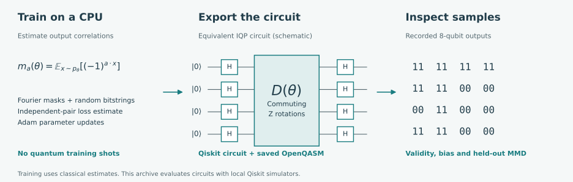
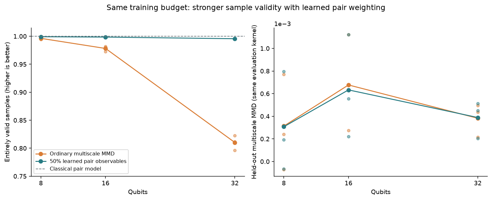
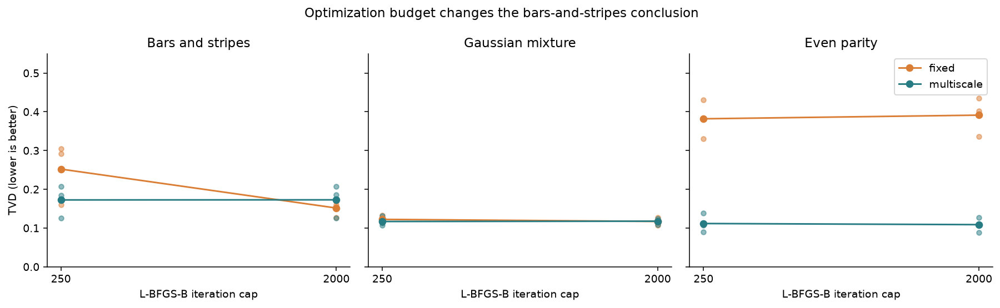

# Quantum generative learning

**Classical training, quantum circuits, and the gap between a low loss and useful samples.**

[](https://github.com/MostafaAbdelmegeed/quantum-generative-learning/actions/workflows/tests.yml)
[](LICENSE)

[Results report](docs/results.md) · [Methods and derivations](docs/iqp-method-notes.md) · [Reproduction guide](docs/reproduction.md) · [Experiment archive](results/README.md)

Can a quantum circuit learn a distribution whose samples satisfy the constraints we care about? This project studies circuit Born machines and instantaneous quantum polynomial (IQP) generators, from exact six-qubit references to classical Monte Carlo training and Qiskit sampling at 32 qubits.



The current release contains **153 experiment records across seven series**, with three seeds per comparison, frozen configurations and archived training source. All execution used local classical hardware and Qiskit simulators. The 32-qubit example is classically tractable; these experiments establish no quantum advantage.

## A loss can miss the constraint that matters

The larger task repeats independent binary variables in adjacent pairs. A valid output must satisfy every pair, for example `00 11 00 11`. At 32 qubits, the first generator achieved 98.5% agreement per pair, but only **81.0% of complete samples** were valid.

The follow-up gives half the training mask budget to strong pair correlations selected from the training data. With the same data, initial parameters and optimization budget, complete-sample validity rises to **99.6%**. The original held-out kernel score barely changes.



*Lines show three-seed means; small points show individual runs. Each run draws 2,048 unfiltered samples from a noiseless Qiskit matrix product state simulator. The validity axis is restricted to 75–101.5% to show the differences. The informed classical pair model achieves 100% validity.*

| Qubits | Ordinary multiscale MMD | Pair-weighted training | Informed classical model |
|---|---:|---:|---:|
| 8 | 99.63% | 99.92% | 100% |
| 16 | 97.82% | 99.85% | 100% |
| 32 | 81.02% | 99.56% | 100% |

Both quantum-model training variants use 1,500 Adam updates and 98,304,000 classical phase evaluations per fit. Pair selection adds a small preprocessing cost. The selector sees neither test data nor pair labels, but choosing `n/2` pairs is a task-motivated prior. Validity alone does not establish distributional fidelity; the archive also records marginal bias and held-out MMD. See the [frozen follow-up protocol](docs/pair-priority-protocol.md) and [complete results](docs/results.md#scaling-and-the-kernel-follow-up).

## What is reproduced, and what is added?

The implementation follows [Liu and Wang's circuit Born machines](https://arxiv.org/abs/1804.04168), the [trainability analysis of MMD losses](https://www.nature.com/articles/s41534-024-00902-0), and [Recio-Armengol, Ahmed and Bowles' classical IQP training method](https://arxiv.org/abs/2503.02934).

For an IQP generator, selected output correlations admit classical Monte Carlo estimates. An independent-pair estimator gives an unbiased loss and gradient against the fixed empirical training distribution, without quantum training shots or a full statevector. Qiskit then executes the fitted circuit. The [derivations](docs/iqp-method-notes.md) specify the angle, bit-order and Fourier-kernel conventions.

This repository adds a Qiskit implementation, a controlled connectivity/noise study, and the pair-weighting follow-up above. It compares dense, line and equally sparse random-tree interactions after routing onto a line device. Adaptive kernels have [prior art](https://arxiv.org/abs/2510.08476); no algorithmic novelty or reproduction of the source paper's thousand-qubit experiments is claimed.

## Results that changed the interpretation

| Experiment | Observation | Interpretation |
|---|---|---|
| Optimization budget | On bars-and-stripes, fixed-loss QCBM TVD improved from 0.252 to 0.152 when the iteration cap rose from 250 to 2,000. | The initial comparison with multiscale MMD reversed. |
| Higher-order dependence | At the larger budget, parity TVD was 0.109 with multiscale QCBM and 0.391 with fixed loss. | The choice of kernel matters for this global constraint. |
| Classical IQP training | Dense-circuit parity TVD was 0.100 with Monte Carlo training and 0.091 with exact training. | Classical estimation recovered a similar fit on this small task. |
| Finite-shot training | The chosen 100-update SPSA schedule learned little at either 256 or 1,024 shots per call. | More shots did not repair this optimizer setup. |
| Simulated deployment | Dense circuits required 49 routed CX gates; line circuits required 10. Sparse models often fit worse before noise. | Gate savings came with an expressiveness tradeoff. |

TVD is total variation distance: zero is an exact match, one is disjoint support. Values are means over three seeds. Four classical baselines, all seeds, stopping-rule failures and both optimization budgets remain in the [results report](docs/results.md).



*Small points show individual seeds. Fifteen of the 18 fits at the larger budget satisfied the stopping rule; the three seed-42 fixed-loss fits still reached the cap.*

## Run a new generator

Install [uv](https://docs.astral.sh/uv/getting-started/installation/), then:

```bash
git clone https://github.com/MostafaAbdelmegeed/quantum-generative-learning.git
cd quantum-generative-learning
uv sync --locked --extra dev --python 3.11.15
uv run --locked --extra dev python -m pytest
uv run --locked python examples/demo.py
```

The demo trains a six-qubit Born machine and draws 40 unfiltered Qiskit simulator samples. It saves a figure, fitted parameters and OpenQASM in `artifacts/demo/`. Use `python examples/demo.py --method iqp` with the same `uv run --locked` prefix for classical IQP training. No IBM account or hardware allocation is required.

For an offline view of the saved experiments, open **[`docs/explorer.html`](docs/explorer.html)** from your local clone in a browser. It includes dataset, model, seed and noise controls, plus the 8–32-qubit comparison. GitHub displays the HTML source; download or clone it to use the controls. Six-qubit preview tiles are draws from archived probabilities; the scaling view uses saved Qiskit samples.

## Reproduce the evidence

```bash
# Train the follow-up into a fresh, ignored output directory.
uv run --locked qgen scaling --config config/scaling-pairs-v1.json --output artifacts/scaling-pairs --workers 3

# Recompute metrics and replay all 135 saved noisy evaluations.
uv run --locked qgen audit --output results/connectivity-v1 --deep

# Audit every series and rebuild the release figures.
uv run --locked python scripts/build_release_report.py
```

The [reproduction guide](docs/reproduction.md) covers all series, archived-source replay, figure generation and platform limits. The numerical tests check amplitudes, gradients, unbiased estimators and rejection of corrupted records. A full replay of the initial 27-record series matched every result field except elapsed times; its [comparison receipt](docs/verification/reproduction-v1-replay.json) is included. CI runs tests and selected artifact audits on Windows and Linux.

| Location | Purpose |
|---|---|
| [`src/qgen/`](src/qgen/) | Circuit construction, estimation, training, deployment and auditing |
| [`config/`](config/) | Seven frozen experiment configurations |
| [`results/`](results/README.md) | Complete records, manifests, source snapshots and checksums |
| [`tests/`](tests/) | Numerical oracles, estimator checks and corruption checks |
| [`docs/`](docs/README.md) | Protocols, derivations, results and the offline explorer |
| [`scripts/`](scripts/) | Report generation and archived-source replay |

## Current scope

The small-system comparisons use synthetic distributions with known evaluation targets. The 32-qubit circuits and paired-bit target are easy to simulate classically. The six-qubit noise model includes depolarizing gate errors; it excludes readout errors, relaxation and crosstalk. No hardware runs or 32-qubit noise results are included.

The [work plan](docs/plan.md) now focuses on separating selector design from optimization sensitivity before increasing width. The earlier [neuroimaging benchmark](https://github.com/MostafaAbdelmegeed/quantum-neuro-ml) is maintained as a separate study.

The [six-qubit follow-up](docs/observable-generalization-results.md) now tests shuffled pairs, corrupted pairs and three- and four-bit parity under a frozen 400-update budget. Learned weighting did not reliably improve TVD, and the classical model using the selected features had lower mean TVD in all five conditions. The follow-up preserves 90 circuit fits, 90 learned classical fits and 15 oracle references in a separate [audited archive](results/observable-generalization-v1/). Its exact-moment controls use the same sampled masks and Adam schedule; they expose failures that remain after removing moment-estimation noise.

## References and citation

1. Liu and Wang (2018). *Differentiable learning of quantum circuit Born machines.* [arXiv:1804.04168](https://arxiv.org/abs/1804.04168).
2. Rudolph et al. (2024). *Trainability barriers and opportunities in quantum generative modeling.* [npj Quantum Information 10, 116](https://www.nature.com/articles/s41534-024-00902-0).
3. Recio-Armengol, Ahmed and Bowles (2025; revised 2026). *Train on classical, deploy on quantum.* [arXiv:2503.02934](https://arxiv.org/abs/2503.02934).
4. *IQPopt* and its classical expectation estimator. [Paper](https://arxiv.org/abs/2501.04776) · [Author implementation](https://github.com/XanaduAI/iqpopt).

This is an independent implementation. To cite this code and experiment archive, use [`CITATION.cff`](CITATION.cff) and record the commit used. Code is licensed under [MIT](LICENSE).
