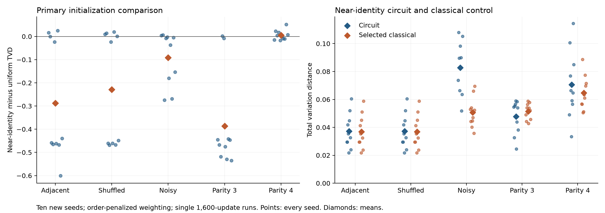

# Initialization replication on ten new seeds

The initialization benefit met the frozen replication criterion on three-bit parity and noisy pairs. With order-penalized weighting and one 1,600-update run, small near-identity starts reduced three-bit parity mean TVD from 0.4343 to 0.0477 and improved nine of ten paired seeds. The earlier four-bit parity improvement did not persist: its mean TVD rose from 0.0655 to 0.0706.

This study used seeds 1001–1010, which were absent from earlier experiment configurations. It retained all five targets, four losses, three initialization families and both update allocations. The [configuration receipt](verification/initialization-replication-controls.json) verifies all 15 inherited settings and the disjoint seed lists. The old three-seed discovery results are not pooled into the replication estimates.

## The primary comparison

The [protocol](initialization-replication-protocol.md) declared near-identity minus uniform exact target TVD under order-penalized weighting with a single 1,600-update run as the primary comparison. A condition had to improve mean TVD by more than 0.01 and improve at least eight of ten seeds. This is a descriptive consistency criterion, not a significance test.

| Target | Uniform mean TVD | Near-identity mean TVD | Mean difference | Seeds improved | Criterion met |
|---|---:|---:|---:|---:|---|
| Adjacent pairs | 0.3246 | 0.0372 | -0.2874 | 7/10 | No |
| Shuffled pairs | 0.2658 | 0.0372 | -0.2286 | 6/10 | No |
| Noisy pairs | 0.1746 | 0.0828 | -0.0917 | 8/10 | Yes |
| Three-bit parity | 0.4343 | 0.0477 | -0.3866 | 9/10 | Yes |
| Four-bit parity | 0.0655 | 0.0706 | +0.0051 | 5/10 | No |

The near-identity three-bit parity fits stayed between TVD 0.0245 and 0.0591 across all ten seeds. Uniform starts ranged from 0.0552 to 0.5732. The improvement is therefore substantial on this target under the fixed schedule, rather than a small shift in an already good mean.

Clean pairs show why the mean and consistency requirements were separate. Their near-identity means improved substantially, and all near-identity outcomes were between roughly 0.0218 and 0.0605. Uniform starts sometimes fitted well enough to beat them on target TVD. The mean gains partly came from avoiding poor uniform-start solutions; neither clean-pair condition reached the declared eight-of-ten threshold. Adjacent and shuffled pairs share latent data draws and cannot be counted as independent replications.

Points show every new seed; diamonds show means. Negative differences in the left panel favor near-identity initialization. The right panel compares the same fixed circuit policy with the selected classical model. The [primary tables](initialization-replication-primary.md) include medians, ranges, every seed difference and the criterion outcome.

## The classical comparison is less encouraging

The near-identity circuit retained a small mean advantage on three-bit parity, but it had lower TVD than the order-penalized selected classical model on only four of ten seeds. Its mean advantage was 0.0038, with paired differences from -0.0183 to +0.0054. This is weaker evidence than the improvement over uniform circuit initialization.

| Target | Near-identity circuit | Selected classical | Mean circuit minus classical | Circuit lower TVD |
|---|---:|---:|---:|---:|
| Adjacent pairs | 0.0372 | 0.0369 | +0.0003 | 4/10 |
| Shuffled pairs | 0.0372 | 0.0369 | +0.0003 | 4/10 |
| Noisy pairs | 0.0828 | 0.0507 | +0.0322 | 0/10 |
| Three-bit parity | 0.0477 | 0.0515 | -0.0038 | 4/10 |
| Four-bit parity | 0.0706 | 0.0647 | +0.0059 | 6/10 |

On four-bit parity, the circuit's earlier mean advantage over this classical control reversed. Six new seeds still favored the circuit, but the regressions on the remaining seeds were large enough to raise its mean. On noisy pairs, the classical control had lower TVD on every seed. Clean-pair means were close to the classical result.

All classical models were refitted on the new training samples with their previous settings. Their capacities and optimizer costs are not matched to the circuit. These findings support a better circuit-training setup for some targets; they do not establish a consistent advantage over the selected classical model or a quantum computational advantage.

## Restarts remain an unreliable general prescription

Across all 600 restart-minus-single comparisons, target TVD improved in 303, worsened in 288 and differed by at most 1e-8 in nine. The mean difference was -0.0591. These comparisons share datasets and include related losses; they are not 600 independent trials.

Restarts lowered final empirical training loss by more than 1e-8 in 278 comparisons. In 113 of those, target TVD increased by more than 1e-8. Selection used only the final training loss and occurred before evaluation, so the discrepancy reflects the difference between the selection objective and target fidelity. It does not justify replacing the chosen candidate with the one that looks best on the evaluation target.

The [complete tables](initialization-replication-tables.md) retain every loss, initialization and allocation, including policies outside the primary comparison. The [summary](initialization-replication-summary.json) contains all 1,200 selected policies, all 3,000 candidates, the 400 classical/reference distributions, secondary metrics and all paired differences. No policy was dropped because it performed poorly.

## Costs, failures and verification

Every policy used 1,600 gradient updates and 6,553,600 classical training phase evaluations. Initial and final objective diagnostics added 8,192 phase evaluations for a single start and 32,768 for four starts. Every candidate received 2,048 Qiskit simulator samples, including candidates that were not selected. These are evaluation samples, not quantum training shots. No physical hardware was used.

All 3,000 circuit candidates completed without execution failures. Adam ran for its fixed budget; convergence was not asserted. Ten order-four classical maximum-entropy fits, all on noisy-pair datasets, reached the 300-iteration limit. Their parameters, diagnostics and outcomes remain in the archive. The other classical stopping records and any warnings are retained as well.

The [archive](../results/initialization-replication-v1/) preserves the frozen protocol, configuration, lockfile, package source, raw data, all initializations, histories and evaluation outputs. All 87 numerical tests passed. They cover deterministic starts, shared budgets, training-only selection, fresh classical references and the prespecified decision rule.

The [audit receipt](../results/initialization-replication-v1/audit.json) records 3,000 circuit training replays and checks of all 400 classical/reference distributions, including refitting the 350 learned controls. A separate rerun of the archived source reproduced all 50 records exactly except elapsed-time fields in the recorded Windows environment; its [comparison receipt](verification/initialization-replication-v1-replay.json) is saved. These checks do not certify optimizer optimality or guarantee identical training trajectories on other machines.

## What to test next

The most convincing result is the repeatable improvement in three-bit parity optimization at the same update budget. The evidence for better performance than the selected classical model remains weak, and the four-bit discovery gain did not replicate.

A bounded next experiment could vary training-set size while keeping the initialization, loss and classical controls fixed. That would test how much of the remaining target-fidelity gap depends on finite training data. It should preserve the distinction between lower training loss and better target TVD, with new criteria frozen before collecting outcomes.
