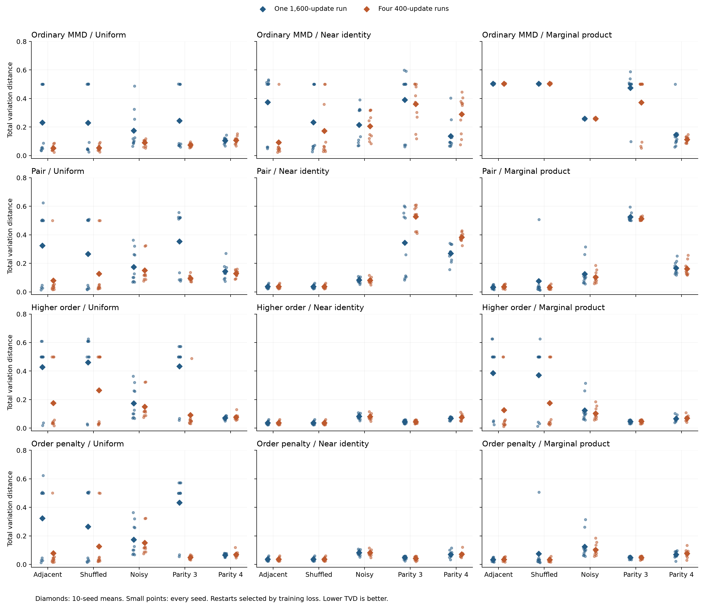

# Initialization and restarts: complete tables

Values are mean exact TVD over 10 seeds: 1001, 1002, 1003, 1004, 1005, 1006, 1007, 1008, 1009, 1010. Every policy uses 1,600 gradient updates. The [protocol](initialization-replication-protocol.md) fixes the starts and training-only selection rule. The [summary JSON](initialization-replication-summary.json) contains all 1,200 selected policies, all 3,000 candidates, secondary metrics and every paired difference.

## Uniform, restarts

| Condition | Ordinary MMD | Pair | Higher order | Order penalty |
|---|---:|---:|---:|---:|
| Adjacent pairs | 0.0525 | 0.0793 | 0.1760 | 0.0793 |
| Shuffled pairs | 0.0550 | 0.1262 | 0.2660 | 0.1262 |
| Noisy pairs | 0.0900 | 0.1513 | 0.1513 | 0.1513 |
| Three-bit parity | 0.0739 | 0.0954 | 0.0925 | 0.0498 |
| Four-bit parity | 0.1068 | 0.1287 | 0.0769 | 0.0702 |

## Uniform, single

| Condition | Ordinary MMD | Pair | Higher order | Order penalty |
|---|---:|---:|---:|---:|
| Adjacent pairs | 0.2315 | 0.3246 | 0.4276 | 0.3246 |
| Shuffled pairs | 0.2299 | 0.2658 | 0.4617 | 0.2658 |
| Noisy pairs | 0.1752 | 0.1746 | 0.1746 | 0.1746 |
| Three-bit parity | 0.2446 | 0.3531 | 0.4343 | 0.4343 |
| Four-bit parity | 0.1050 | 0.1433 | 0.0710 | 0.0655 |

## Near identity, restarts

| Condition | Ordinary MMD | Pair | Higher order | Order penalty |
|---|---:|---:|---:|---:|
| Adjacent pairs | 0.0935 | 0.0372 | 0.0372 | 0.0372 |
| Shuffled pairs | 0.1727 | 0.0372 | 0.0372 | 0.0372 |
| Noisy pairs | 0.2055 | 0.0816 | 0.0816 | 0.0816 |
| Three-bit parity | 0.3620 | 0.5273 | 0.0439 | 0.0431 |
| Four-bit parity | 0.2906 | 0.3830 | 0.0761 | 0.0717 |

## Near identity, single

| Condition | Ordinary MMD | Pair | Higher order | Order penalty |
|---|---:|---:|---:|---:|
| Adjacent pairs | 0.3739 | 0.0372 | 0.0372 | 0.0372 |
| Shuffled pairs | 0.2325 | 0.0372 | 0.0372 | 0.0372 |
| Noisy pairs | 0.2143 | 0.0828 | 0.0828 | 0.0828 |
| Three-bit parity | 0.3905 | 0.3451 | 0.0453 | 0.0477 |
| Four-bit parity | 0.1357 | 0.2688 | 0.0674 | 0.0706 |

## Marginal product, restarts

| Condition | Ordinary MMD | Pair | Higher order | Order penalty |
|---|---:|---:|---:|---:|
| Adjacent pairs | 0.5043 | 0.0355 | 0.1270 | 0.0355 |
| Shuffled pairs | 0.5044 | 0.0325 | 0.1760 | 0.0325 |
| Noisy pairs | 0.2586 | 0.1035 | 0.1035 | 0.1035 |
| Three-bit parity | 0.3720 | 0.5133 | 0.0473 | 0.0476 |
| Four-bit parity | 0.1136 | 0.1616 | 0.0693 | 0.0762 |

## Marginal product, single

| Condition | Ordinary MMD | Pair | Higher order | Order penalty |
|---|---:|---:|---:|---:|
| Adjacent pairs | 0.5041 | 0.0329 | 0.3871 | 0.0329 |
| Shuffled pairs | 0.5037 | 0.0751 | 0.3714 | 0.0751 |
| Noisy pairs | 0.2583 | 0.1247 | 0.1247 | 0.1247 |
| Three-bit parity | 0.4739 | 0.5254 | 0.0457 | 0.0477 |
| Four-bit parity | 0.1459 | 0.1667 | 0.0668 | 0.0691 |

## Classical references

These learned models use the same data; their capacities and optimizer costs are not matched to the circuit fits. The oracle has TVD zero and is not a learned model.

| Condition | Empirical | Independent | Pairwise | Autoregressive | Higher-order selected | Order-4 | Order-penalized selected |
|---|---:|---:|---:|---:|---:|---:|---:|
| Adjacent pairs | 0.0523 | 0.8741 | 0.0519 | 0.0555 | 0.0369 | 0.0524 | 0.0369 |
| Shuffled pairs | 0.0523 | 0.8741 | 0.0519 | 0.0537 | 0.0369 | 0.0524 | 0.0369 |
| Noisy pairs | 0.0986 | 0.6032 | 0.0731 | 0.0764 | 0.0507 | 0.0978 | 0.0507 |
| Three-bit parity | 0.0662 | 0.7500 | 0.7469 | 0.0733 | 0.0515 | 0.0664 | 0.0515 |
| Four-bit parity | 0.0982 | 0.5000 | 0.4967 | 0.0851 | 0.0664 | 0.0984 | 0.0647 |

## Restart minus single differences

Negative values favor the first policy. Differences are paired on dataset seed, loss and the settings not being varied.

| Condition | Loss | Initialization | Allocation | Seed 1001 | Seed 1002 | Seed 1003 | Seed 1004 | Seed 1005 | Seed 1006 | Seed 1007 | Seed 1008 | Seed 1009 | Seed 1010 |
|---|---|---|---|---:|---:|---:|---:|---:|---:|---:|---:|---:|---:|
| Adjacent pairs | Higher order | Marginal product | restarts | -0.1250 | -0.4707 | -0.1250 | -0.4879 | -0.4782 | -0.0000 | -0.0001 | -0.4736 | +0.0002 | -0.4404 |
| Adjacent pairs | Higher order | Near identity | restarts | -0.0000 | -0.0000 | -0.0000 | +0.0000 | +0.0000 | -0.0000 | -0.0000 | -0.0000 | -0.0000 | +0.0000 |
| Adjacent pairs | Higher order | Uniform | restarts | -0.0000 | -0.5776 | -0.4602 | -0.4641 | -0.5646 | -0.0001 | +0.0153 | -0.0000 | -0.4835 | +0.0194 |
| Adjacent pairs | Ordinary MMD | Marginal product | restarts | +0.0003 | +0.0009 | -0.0000 | +0.0001 | +0.0010 | +0.0000 | -0.0018 | +0.0007 | +0.0011 | +0.0000 |
| Adjacent pairs | Ordinary MMD | Near identity | restarts | -0.4896 | -0.4557 | +0.0006 | -0.0127 | -0.0030 | +0.0003 | -0.4540 | -0.4818 | -0.4938 | -0.4145 |
| Adjacent pairs | Ordinary MMD | Uniform | restarts | -0.0017 | +0.0051 | +0.0000 | -0.4594 | +0.0073 | -0.4472 | +0.0349 | -0.4530 | -0.4768 | +0.0003 |
| Adjacent pairs | Order penalty | Marginal product | restarts | +0.0005 | -0.0000 | -0.0004 | +0.0001 | +0.0000 | +0.0067 | +0.0001 | +0.0001 | +0.0001 | +0.0196 |
| Adjacent pairs | Order penalty | Near identity | restarts | -0.0000 | +0.0000 | +0.0000 | +0.0000 | +0.0000 | +0.0000 | -0.0000 | +0.0000 | -0.0000 | -0.0000 |
| Adjacent pairs | Order penalty | Uniform | restarts | +0.0065 | -0.0001 | +0.0003 | -0.4851 | +0.0010 | -0.4615 | +0.0060 | -0.4675 | -0.6069 | -0.4458 |
| Adjacent pairs | Pair | Marginal product | restarts | +0.0005 | -0.0000 | -0.0004 | +0.0001 | +0.0000 | +0.0067 | +0.0001 | +0.0001 | +0.0001 | +0.0196 |
| Adjacent pairs | Pair | Near identity | restarts | -0.0000 | +0.0000 | +0.0000 | +0.0000 | +0.0000 | +0.0000 | -0.0000 | +0.0000 | -0.0000 | -0.0000 |
| Adjacent pairs | Pair | Uniform | restarts | +0.0065 | -0.0001 | +0.0003 | -0.4851 | +0.0010 | -0.4615 | +0.0060 | -0.4675 | -0.6069 | -0.4458 |
| Noisy pairs | Higher order | Marginal product | restarts | -0.0049 | -0.0042 | -0.0084 | +0.0296 | -0.0121 | -0.0771 | +0.0417 | +0.0058 | -0.2357 | +0.0525 |
| Noisy pairs | Higher order | Near identity | restarts | -0.0029 | +0.0083 | -0.0081 | -0.0028 | -0.0054 | +0.0037 | -0.0019 | -0.0034 | +0.0025 | -0.0020 |
| Noisy pairs | Higher order | Uniform | restarts | +0.0058 | +0.0149 | -0.2749 | +0.0447 | +0.0451 | +0.0597 | -0.0044 | -0.2084 | +0.0196 | +0.0650 |
| Noisy pairs | Ordinary MMD | Marginal product | restarts | +0.0004 | +0.0047 | -0.0000 | +0.0059 | +0.0000 | -0.0000 | -0.0083 | +0.0016 | -0.0000 | -0.0015 |
| Noisy pairs | Ordinary MMD | Near identity | restarts | +0.1754 | +0.0290 | -0.0108 | +0.0775 | -0.0002 | +0.0007 | -0.0581 | -0.0698 | -0.2367 | +0.0051 |
| Noisy pairs | Ordinary MMD | Uniform | restarts | -0.0052 | -0.0104 | +0.0157 | +0.0005 | -0.0001 | +0.0006 | -0.2212 | -0.2026 | -0.4215 | -0.0083 |
| Noisy pairs | Order penalty | Marginal product | restarts | -0.0049 | -0.0042 | -0.0084 | +0.0296 | -0.0121 | -0.0771 | +0.0417 | +0.0058 | -0.2357 | +0.0525 |
| Noisy pairs | Order penalty | Near identity | restarts | -0.0029 | +0.0083 | -0.0081 | -0.0028 | -0.0054 | +0.0037 | -0.0019 | -0.0034 | +0.0025 | -0.0020 |
| Noisy pairs | Order penalty | Uniform | restarts | +0.0058 | +0.0149 | -0.2749 | +0.0447 | +0.0451 | +0.0597 | -0.0044 | -0.2084 | +0.0196 | +0.0650 |
| Noisy pairs | Pair | Marginal product | restarts | -0.0049 | -0.0042 | -0.0084 | +0.0296 | -0.0121 | -0.0771 | +0.0417 | +0.0058 | -0.2357 | +0.0525 |
| Noisy pairs | Pair | Near identity | restarts | -0.0029 | +0.0083 | -0.0081 | -0.0028 | -0.0054 | +0.0037 | -0.0019 | -0.0034 | +0.0025 | -0.0020 |
| Noisy pairs | Pair | Uniform | restarts | +0.0058 | +0.0149 | -0.2749 | +0.0447 | +0.0451 | +0.0597 | -0.0044 | -0.2084 | +0.0196 | +0.0650 |
| Three-bit parity | Higher order | Marginal product | restarts | +0.0001 | -0.0035 | -0.0005 | +0.0146 | +0.0003 | +0.0001 | -0.0035 | +0.0030 | +0.0053 | -0.0001 |
| Three-bit parity | Higher order | Near identity | restarts | -0.0002 | -0.0025 | -0.0007 | +0.0025 | +0.0000 | +0.0055 | -0.0084 | -0.0017 | -0.0070 | -0.0016 |
| Three-bit parity | Higher order | Uniform | restarts | -0.4606 | -0.4656 | -0.5139 | -0.0021 | +0.0000 | -0.4691 | -0.5206 | -0.4516 | -0.4497 | -0.0848 |
| Three-bit parity | Ordinary MMD | Marginal product | restarts | -0.0084 | -0.0001 | -0.0000 | -0.4351 | -0.0375 | -0.5357 | +0.0010 | -0.0039 | +0.0011 | -0.0007 |
| Three-bit parity | Ordinary MMD | Near identity | restarts | +0.0003 | -0.0002 | -0.2251 | +0.3462 | +0.0868 | -0.0174 | -0.0007 | +0.0440 | -0.1965 | -0.3224 |
| Three-bit parity | Ordinary MMD | Uniform | restarts | -0.4300 | -0.0166 | -0.0005 | -0.0078 | +0.0280 | -0.4422 | -0.4242 | -0.4169 | +0.0067 | -0.0035 |
| Three-bit parity | Order penalty | Marginal product | restarts | -0.0000 | -0.0035 | -0.0005 | -0.0034 | +0.0003 | -0.0013 | -0.0035 | +0.0030 | +0.0045 | +0.0039 |
| Three-bit parity | Order penalty | Near identity | restarts | -0.0007 | -0.0025 | -0.0007 | -0.0054 | +0.0000 | -0.0041 | -0.0084 | -0.0017 | -0.0126 | -0.0105 |
| Three-bit parity | Order penalty | Uniform | restarts | -0.4599 | -0.4656 | -0.5139 | -0.0023 | +0.0000 | -0.4678 | -0.5206 | -0.4516 | -0.4502 | -0.5130 |
| Three-bit parity | Pair | Marginal product | restarts | -0.0135 | -0.0038 | +0.0005 | -0.0000 | -0.0711 | -0.0003 | -0.0263 | -0.0013 | +0.0169 | -0.0221 |
| Three-bit parity | Pair | Near identity | restarts | +0.0305 | +0.0167 | +0.0065 | +0.3381 | +0.4455 | -0.0023 | +0.0906 | +0.4304 | +0.1614 | +0.3049 |
| Three-bit parity | Pair | Uniform | restarts | -0.4345 | -0.3972 | -0.4471 | +0.0039 | +0.0033 | -0.4451 | -0.4313 | -0.4245 | -0.0062 | +0.0017 |
| Four-bit parity | Higher order | Marginal product | restarts | +0.0123 | +0.0061 | +0.0178 | +0.0000 | -0.0057 | +0.0026 | -0.0036 | +0.0003 | +0.0025 | -0.0076 |
| Four-bit parity | Higher order | Near identity | restarts | +0.0008 | +0.0434 | -0.0027 | -0.0011 | -0.0267 | +0.0286 | +0.0298 | +0.0062 | -0.0011 | +0.0096 |
| Four-bit parity | Higher order | Uniform | restarts | +0.0012 | +0.0098 | -0.0017 | +0.0038 | +0.0066 | +0.0091 | +0.0570 | -0.0157 | -0.0124 | +0.0016 |
| Four-bit parity | Ordinary MMD | Marginal product | restarts | +0.0269 | +0.0002 | -0.3669 | -0.0003 | +0.0178 | -0.0004 | +0.0210 | -0.0247 | +0.0104 | -0.0068 |
| Four-bit parity | Ordinary MMD | Near identity | restarts | +0.0085 | +0.1556 | +0.2852 | +0.0611 | +0.0474 | -0.0361 | +0.3713 | +0.1003 | +0.2781 | +0.2776 |
| Four-bit parity | Ordinary MMD | Uniform | restarts | -0.0011 | +0.0000 | -0.0177 | -0.0039 | -0.0009 | -0.0007 | -0.0010 | -0.0010 | +0.0362 | +0.0086 |
| Four-bit parity | Order penalty | Marginal product | restarts | +0.0298 | +0.0071 | +0.0178 | -0.0009 | +0.0082 | +0.0429 | -0.0386 | +0.0096 | -0.0007 | -0.0049 |
| Four-bit parity | Order penalty | Near identity | restarts | +0.0060 | -0.0459 | -0.0027 | +0.0087 | +0.0151 | +0.0139 | +0.0051 | +0.0111 | +0.0073 | -0.0075 |
| Four-bit parity | Order penalty | Uniform | restarts | +0.0008 | +0.0404 | -0.0017 | +0.0077 | -0.0044 | -0.0007 | +0.0012 | -0.0013 | +0.0006 | +0.0044 |
| Four-bit parity | Pair | Marginal product | restarts | -0.0000 | +0.0179 | -0.0743 | -0.0000 | +0.0146 | -0.0246 | -0.0004 | +0.0158 | -0.0051 | +0.0050 |
| Four-bit parity | Pair | Near identity | restarts | +0.1188 | +0.2180 | +0.0234 | +0.1166 | +0.0791 | +0.1413 | +0.0935 | +0.1160 | +0.1629 | +0.0718 |
| Four-bit parity | Pair | Uniform | restarts | +0.0007 | -0.0215 | +0.0173 | -0.0024 | +0.0559 | -0.0122 | -0.0352 | -0.1293 | +0.0116 | -0.0309 |
| Shuffled pairs | Higher order | Marginal product | restarts | +0.0153 | -0.4706 | -0.0001 | +0.0002 | -0.4783 | -0.4552 | -0.0000 | +0.0000 | +0.0000 | -0.5646 |
| Shuffled pairs | Higher order | Near identity | restarts | -0.0000 | +0.0000 | +0.0000 | +0.0000 | +0.0000 | -0.0000 | +0.0000 | +0.0000 | -0.0000 | +0.0000 |
| Shuffled pairs | Higher order | Uniform | restarts | -0.0000 | +0.0001 | -0.0006 | -0.5801 | -0.5644 | -0.1100 | -0.5921 | -0.0000 | -0.1100 | -0.0001 |
| Shuffled pairs | Ordinary MMD | Marginal product | restarts | +0.0003 | -0.0004 | +0.0018 | +0.0000 | +0.0000 | +0.0000 | +0.0002 | +0.0001 | +0.0008 | +0.0037 |
| Shuffled pairs | Ordinary MMD | Near identity | restarts | +0.0017 | +0.0024 | +0.0010 | +0.3072 | -0.0034 | +0.0003 | -0.4598 | +0.0003 | -0.4705 | +0.0219 |
| Shuffled pairs | Ordinary MMD | Uniform | restarts | -0.4634 | +0.0113 | -0.0000 | -0.4613 | +0.0236 | +0.0187 | -0.4172 | -0.4601 | +0.0000 | +0.0000 |
| Shuffled pairs | Order penalty | Marginal product | restarts | +0.0003 | +0.0047 | +0.0063 | -0.0004 | -0.0001 | -0.4808 | -0.0001 | -0.0003 | +0.0003 | +0.0439 |
| Shuffled pairs | Order penalty | Near identity | restarts | +0.0000 | +0.0000 | +0.0000 | +0.0000 | +0.0000 | +0.0000 | -0.0000 | +0.0000 | -0.0000 | +0.0000 |
| Shuffled pairs | Order penalty | Uniform | restarts | +0.0013 | +0.0172 | -0.4800 | -0.4733 | +0.0002 | -0.0054 | +0.0195 | -0.4669 | +0.0004 | -0.0089 |
| Shuffled pairs | Pair | Marginal product | restarts | +0.0003 | +0.0047 | +0.0063 | -0.0004 | -0.0001 | -0.4808 | -0.0001 | -0.0003 | +0.0003 | +0.0439 |
| Shuffled pairs | Pair | Near identity | restarts | +0.0000 | +0.0000 | +0.0000 | +0.0000 | +0.0000 | +0.0000 | -0.0000 | +0.0000 | -0.0000 | +0.0000 |
| Shuffled pairs | Pair | Uniform | restarts | +0.0013 | +0.0172 | -0.4800 | -0.4733 | +0.0002 | -0.0054 | +0.0195 | -0.4669 | +0.0004 | -0.0089 |

## Initialization minus uniform differences

Negative values favor the first policy. Differences are paired on dataset seed, loss and the settings not being varied.

| Condition | Loss | Initialization | Allocation | Seed 1001 | Seed 1002 | Seed 1003 | Seed 1004 | Seed 1005 | Seed 1006 | Seed 1007 | Seed 1008 | Seed 1009 | Seed 1010 |
|---|---|---|---|---:|---:|---:|---:|---:|---:|---:|---:|---:|---:|
| Adjacent pairs | Higher order | Marginal product | restarts | +0.0000 | -0.0030 | +0.4602 | -0.0238 | -0.0236 | -0.4551 | +0.0180 | -0.4736 | +0.0077 | +0.0029 |
| Adjacent pairs | Higher order | Marginal product | single | +0.1250 | -0.1100 | +0.1250 | +0.0000 | -0.1100 | -0.4551 | +0.0334 | -0.0000 | -0.4761 | +0.4628 |
| Adjacent pairs | Higher order | Near identity | restarts | -0.4704 | -0.0029 | +0.0020 | -0.0005 | -0.0236 | -0.4551 | +0.0181 | -0.4674 | +0.0074 | +0.0038 |
| Adjacent pairs | Higher order | Near identity | single | -0.4704 | -0.5805 | -0.4582 | -0.4646 | -0.5882 | -0.4551 | +0.0334 | -0.4674 | -0.4761 | +0.0233 |
| Adjacent pairs | Ordinary MMD | Marginal product | restarts | +0.4669 | +0.4637 | +0.4526 | +0.4614 | +0.4382 | +0.4545 | +0.4251 | +0.4571 | +0.4784 | +0.4201 |
| Adjacent pairs | Ordinary MMD | Marginal product | single | +0.4649 | +0.4679 | +0.4526 | +0.0019 | +0.4446 | +0.0073 | +0.4618 | +0.0034 | +0.0005 | +0.4204 |
| Adjacent pairs | Ordinary MMD | Near identity | restarts | -0.0114 | +0.0061 | +0.0075 | -0.0049 | -0.0076 | +0.4476 | -0.0371 | +0.0020 | +0.0064 | +0.0015 |
| Adjacent pairs | Ordinary MMD | Near identity | single | +0.4765 | +0.4669 | +0.0069 | -0.4515 | +0.0027 | +0.0001 | +0.4518 | +0.0308 | +0.0235 | +0.4163 |
| Adjacent pairs | Order penalty | Marginal product | restarts | +0.0008 | +0.0029 | -0.4607 | +0.0151 | +0.0034 | -0.0186 | +0.0189 | -0.0001 | -0.0007 | +0.0008 |
| Adjacent pairs | Order penalty | Marginal product | single | +0.0068 | +0.0028 | -0.4599 | -0.4701 | +0.0044 | -0.4868 | +0.0249 | -0.4677 | -0.6076 | -0.4646 |
| Adjacent pairs | Order penalty | Near identity | restarts | +0.0093 | +0.0001 | -0.4585 | +0.0205 | -0.0249 | +0.0001 | +0.0188 | +0.0001 | +0.0067 | +0.0063 |
| Adjacent pairs | Order penalty | Near identity | single | +0.0158 | +0.0000 | -0.4582 | -0.4646 | -0.0239 | -0.4613 | +0.0248 | -0.4674 | -0.6002 | -0.4395 |
| Adjacent pairs | Pair | Marginal product | restarts | +0.0008 | +0.0029 | -0.4607 | +0.0151 | +0.0034 | -0.0186 | +0.0189 | -0.0001 | -0.0007 | +0.0008 |
| Adjacent pairs | Pair | Marginal product | single | +0.0068 | +0.0028 | -0.4599 | -0.4701 | +0.0044 | -0.4868 | +0.0249 | -0.4677 | -0.6076 | -0.4646 |
| Adjacent pairs | Pair | Near identity | restarts | +0.0093 | +0.0001 | -0.4585 | +0.0205 | -0.0249 | +0.0001 | +0.0188 | +0.0001 | +0.0067 | +0.0063 |
| Adjacent pairs | Pair | Near identity | single | +0.0158 | +0.0000 | -0.4582 | -0.4646 | -0.0239 | -0.4613 | +0.0248 | -0.4674 | -0.6002 | -0.4395 |
| Noisy pairs | Higher order | Marginal product | restarts | -0.0178 | -0.0095 | -0.0177 | -0.0240 | -0.0586 | -0.1367 | +0.0129 | -0.0502 | -0.0085 | -0.1685 |
| Noisy pairs | Higher order | Marginal product | single | -0.0070 | +0.0095 | -0.2842 | -0.0089 | -0.0014 | +0.0001 | -0.0331 | -0.2644 | +0.2468 | -0.1560 |
| Noisy pairs | Higher order | Near identity | restarts | -0.0044 | -0.0001 | -0.0071 | -0.0559 | -0.0530 | -0.2358 | -0.0341 | -0.0641 | -0.0215 | -0.2206 |
| Noisy pairs | Higher order | Near identity | single | +0.0044 | +0.0065 | -0.2739 | -0.0084 | -0.0025 | -0.1799 | -0.0366 | -0.2690 | -0.0044 | -0.1536 |
| Noisy pairs | Ordinary MMD | Marginal product | restarts | +0.1963 | +0.1576 | +0.1537 | +0.1773 | +0.1598 | +0.1521 | +0.1536 | +0.2047 | +0.1900 | +0.1410 |
| Noisy pairs | Ordinary MMD | Marginal product | single | +0.1907 | +0.1425 | +0.1694 | +0.1720 | +0.1597 | +0.1527 | -0.0593 | +0.0004 | -0.2315 | +0.1342 |
| Noisy pairs | Ordinary MMD | Near identity | restarts | +0.1836 | +0.0130 | -0.0064 | +0.0631 | +0.2192 | +0.2161 | +0.1627 | +0.2666 | +0.0174 | +0.0203 |
| Noisy pairs | Ordinary MMD | Near identity | single | +0.0031 | -0.0265 | +0.0201 | -0.0139 | +0.2193 | +0.2161 | -0.0004 | +0.1338 | -0.1675 | +0.0069 |
| Noisy pairs | Order penalty | Marginal product | restarts | -0.0178 | -0.0095 | -0.0177 | -0.0240 | -0.0586 | -0.1367 | +0.0129 | -0.0502 | -0.0085 | -0.1685 |
| Noisy pairs | Order penalty | Marginal product | single | -0.0070 | +0.0095 | -0.2842 | -0.0089 | -0.0014 | +0.0001 | -0.0331 | -0.2644 | +0.2468 | -0.1560 |
| Noisy pairs | Order penalty | Near identity | restarts | -0.0044 | -0.0001 | -0.0071 | -0.0559 | -0.0530 | -0.2358 | -0.0341 | -0.0641 | -0.0215 | -0.2206 |
| Noisy pairs | Order penalty | Near identity | single | +0.0044 | +0.0065 | -0.2739 | -0.0084 | -0.0025 | -0.1799 | -0.0366 | -0.2690 | -0.0044 | -0.1536 |
| Noisy pairs | Pair | Marginal product | restarts | -0.0178 | -0.0095 | -0.0177 | -0.0240 | -0.0586 | -0.1367 | +0.0129 | -0.0502 | -0.0085 | -0.1685 |
| Noisy pairs | Pair | Marginal product | single | -0.0070 | +0.0095 | -0.2842 | -0.0089 | -0.0014 | +0.0001 | -0.0331 | -0.2644 | +0.2468 | -0.1560 |
| Noisy pairs | Pair | Near identity | restarts | -0.0044 | -0.0001 | -0.0071 | -0.0559 | -0.0530 | -0.2358 | -0.0341 | -0.0641 | -0.0215 | -0.2206 |
| Noisy pairs | Pair | Near identity | single | +0.0044 | +0.0065 | -0.2739 | -0.0084 | -0.0025 | -0.1799 | -0.0366 | -0.2690 | -0.0044 | -0.1536 |
| Three-bit parity | Higher order | Marginal product | restarts | +0.0153 | -0.0054 | -0.0041 | +0.0027 | -0.0083 | -0.0018 | -0.0110 | +0.0098 | +0.0037 | -0.4529 |
| Three-bit parity | Higher order | Marginal product | single | -0.4453 | -0.4674 | -0.5176 | -0.0139 | -0.0085 | -0.4710 | -0.5280 | -0.4448 | -0.4512 | -0.5376 |
| Three-bit parity | Higher order | Near identity | restarts | +0.0149 | -0.0043 | -0.0047 | -0.0206 | -0.0086 | +0.0049 | -0.0172 | +0.0079 | -0.0038 | -0.4545 |
| Three-bit parity | Higher order | Near identity | single | -0.4455 | -0.4673 | -0.5179 | -0.0252 | -0.0086 | -0.4697 | -0.5294 | -0.4420 | -0.4465 | -0.5378 |
| Three-bit parity | Ordinary MMD | Marginal product | restarts | +0.4301 | +0.4457 | +0.4156 | -0.0009 | +0.4039 | -0.0070 | +0.4246 | +0.0106 | +0.4356 | +0.4222 |
| Three-bit parity | Ordinary MMD | Marginal product | single | +0.0085 | +0.4292 | +0.4151 | +0.4264 | +0.4694 | +0.0865 | -0.0005 | -0.4024 | +0.4412 | +0.4194 |
| Three-bit parity | Ordinary MMD | Near identity | restarts | +0.4295 | +0.4461 | +0.2893 | +0.3540 | +0.0519 | +0.4241 | +0.4241 | +0.0337 | +0.2380 | +0.1903 |
| Three-bit parity | Ordinary MMD | Near identity | single | -0.0008 | +0.4296 | +0.5139 | -0.0000 | -0.0069 | -0.0007 | +0.0006 | -0.4272 | +0.4412 | +0.5092 |
| Three-bit parity | Order penalty | Marginal product | restarts | +0.0145 | -0.0054 | -0.0041 | +0.0001 | -0.0083 | +0.0026 | -0.0110 | +0.0098 | +0.0034 | -0.0233 |
| Three-bit parity | Order penalty | Marginal product | single | -0.4454 | -0.4674 | -0.5176 | +0.0012 | -0.0085 | -0.4639 | -0.5280 | -0.4448 | -0.4512 | -0.5402 |
| Three-bit parity | Order penalty | Near identity | restarts | +0.0138 | -0.0043 | -0.0047 | -0.0019 | -0.0086 | -0.0118 | -0.0172 | +0.0079 | -0.0084 | -0.0325 |
| Three-bit parity | Order penalty | Near identity | single | -0.4455 | -0.4673 | -0.5179 | +0.0013 | -0.0086 | -0.4755 | -0.5294 | -0.4420 | -0.4459 | -0.5350 |
| Three-bit parity | Pair | Marginal product | restarts | +0.4114 | +0.3906 | +0.3918 | +0.4386 | +0.3871 | +0.4289 | +0.4171 | +0.4214 | +0.4481 | +0.4441 |
| Three-bit parity | Pair | Marginal product | single | -0.0096 | -0.0027 | -0.0558 | +0.4426 | +0.4615 | -0.0159 | +0.0121 | -0.0019 | +0.4251 | +0.4680 |
| Three-bit parity | Pair | Near identity | restarts | +0.4937 | +0.4296 | +0.4984 | +0.3338 | +0.4023 | +0.5206 | +0.5199 | +0.4455 | +0.3533 | +0.3215 |
| Three-bit parity | Pair | Near identity | single | +0.0288 | +0.0157 | +0.0449 | -0.0003 | -0.0399 | +0.0777 | -0.0020 | -0.4094 | +0.1857 | +0.0183 |
| Four-bit parity | Higher order | Marginal product | restarts | -0.0136 | +0.0255 | +0.0058 | -0.0162 | -0.0156 | -0.0116 | -0.0558 | -0.0042 | +0.0103 | -0.0012 |
| Four-bit parity | Higher order | Marginal product | single | -0.0247 | +0.0291 | -0.0137 | -0.0124 | -0.0033 | -0.0051 | +0.0047 | -0.0201 | -0.0046 | +0.0079 |
| Four-bit parity | Higher order | Near identity | restarts | -0.0127 | +0.0288 | +0.0026 | -0.0245 | -0.0018 | +0.0184 | -0.0303 | -0.0004 | +0.0135 | -0.0023 |
| Four-bit parity | Higher order | Near identity | single | -0.0123 | -0.0048 | +0.0036 | -0.0196 | +0.0315 | -0.0011 | -0.0031 | -0.0223 | +0.0021 | -0.0103 |
| Four-bit parity | Ordinary MMD | Marginal product | restarts | +0.0071 | +0.0122 | +0.0268 | +0.0071 | +0.0190 | +0.0064 | +0.0087 | -0.0024 | -0.0124 | -0.0042 |
| Four-bit parity | Ordinary MMD | Marginal product | single | -0.0209 | +0.0120 | +0.3760 | +0.0035 | +0.0003 | +0.0061 | -0.0133 | +0.0213 | +0.0134 | +0.0111 |
| Four-bit parity | Ordinary MMD | Near identity | restarts | -0.0035 | +0.1301 | +0.2741 | +0.0692 | +0.0469 | +0.2707 | +0.3349 | +0.2357 | +0.2265 | +0.2533 |
| Four-bit parity | Ordinary MMD | Near identity | single | -0.0131 | -0.0255 | -0.0288 | +0.0043 | -0.0013 | +0.3062 | -0.0373 | +0.1344 | -0.0153 | -0.0158 |
| Four-bit parity | Order penalty | Marginal product | restarts | +0.0159 | -0.0213 | +0.0058 | +0.0028 | -0.0159 | +0.0759 | -0.0177 | -0.0044 | +0.0078 | +0.0110 |
| Four-bit parity | Order penalty | Marginal product | single | -0.0132 | +0.0120 | -0.0137 | +0.0114 | -0.0285 | +0.0323 | +0.0222 | -0.0154 | +0.0091 | +0.0203 |
| Four-bit parity | Order penalty | Near identity | restarts | -0.0098 | -0.0638 | +0.0026 | +0.0179 | +0.0026 | +0.0144 | -0.0049 | +0.0023 | +0.0586 | -0.0046 |
| Four-bit parity | Order penalty | Near identity | single | -0.0150 | +0.0226 | +0.0036 | +0.0169 | -0.0169 | -0.0002 | -0.0088 | -0.0102 | +0.0520 | +0.0073 |
| Four-bit parity | Pair | Marginal product | restarts | +0.0921 | -0.0135 | -0.0205 | +0.0434 | +0.0447 | +0.0037 | +0.0037 | +0.0918 | -0.0321 | +0.1161 |
| Four-bit parity | Pair | Marginal product | single | +0.0928 | -0.0529 | +0.0711 | +0.0410 | +0.0860 | +0.0161 | -0.0311 | -0.0533 | -0.0153 | +0.0801 |
| Four-bit parity | Pair | Near identity | restarts | +0.2803 | +0.2176 | +0.2152 | +0.3044 | +0.2317 | +0.3044 | +0.3130 | +0.1849 | +0.2267 | +0.2647 |
| Four-bit parity | Pair | Near identity | single | +0.1621 | -0.0219 | +0.2091 | +0.1854 | +0.2085 | +0.1509 | +0.1843 | -0.0603 | +0.0754 | +0.1619 |
| Shuffled pairs | Higher order | Marginal product | restarts | -0.4705 | -0.0001 | +0.0192 | +0.4703 | -0.0239 | -0.4552 | +0.4671 | -0.4674 | +0.0000 | -0.4396 |
| Shuffled pairs | Higher order | Marginal product | single | -0.4858 | +0.4706 | +0.0187 | -0.1100 | -0.1099 | -0.1099 | -0.1250 | -0.4674 | -0.1100 | +0.1250 |
| Shuffled pairs | Higher order | Near identity | restarts | -0.4704 | -0.0001 | +0.0193 | +0.0055 | -0.0237 | -0.4551 | +0.0191 | -0.4674 | -0.4761 | -0.4394 |
| Shuffled pairs | Higher order | Near identity | single | -0.4704 | +0.0000 | +0.0188 | -0.5745 | -0.5881 | -0.5651 | -0.5730 | -0.4675 | -0.5860 | -0.4395 |
| Shuffled pairs | Ordinary MMD | Marginal product | restarts | +0.4656 | +0.4474 | +0.4554 | +0.4624 | +0.4367 | +0.4471 | +0.4254 | +0.4601 | +0.4759 | +0.4172 |
| Shuffled pairs | Ordinary MMD | Marginal product | single | +0.0019 | +0.4592 | +0.4536 | +0.0011 | +0.4602 | +0.4658 | +0.0080 | -0.0001 | +0.4752 | +0.4135 |
| Shuffled pairs | Ordinary MMD | Near identity | restarts | -0.0079 | -0.0093 | +0.0163 | +0.3196 | -0.0048 | +0.4402 | -0.0427 | +0.4581 | +0.0040 | +0.0027 |
| Shuffled pairs | Ordinary MMD | Near identity | single | -0.4730 | -0.0004 | +0.0153 | -0.4489 | +0.0222 | +0.4586 | -0.0000 | -0.0023 | +0.4746 | -0.0192 |
| Shuffled pairs | Order penalty | Marginal product | restarts | -0.0009 | +0.0047 | +0.0186 | -0.0124 | -0.0005 | -0.4740 | -0.0205 | -0.0008 | -0.0073 | -0.4435 |
| Shuffled pairs | Order penalty | Marginal product | single | +0.0000 | +0.0172 | -0.4677 | -0.4853 | -0.0002 | +0.0014 | -0.0009 | -0.4675 | -0.0073 | -0.4963 |
| Shuffled pairs | Order penalty | Near identity | restarts | +0.0083 | -0.0025 | +0.0193 | +0.0052 | -0.0243 | -0.4555 | -0.0002 | -0.0005 | -0.0002 | -0.4396 |
| Shuffled pairs | Order penalty | Near identity | single | +0.0096 | +0.0146 | -0.4607 | -0.4682 | -0.0241 | -0.4609 | +0.0193 | -0.4674 | +0.0002 | -0.4485 |
| Shuffled pairs | Pair | Marginal product | restarts | -0.0009 | +0.0047 | +0.0186 | -0.0124 | -0.0005 | -0.4740 | -0.0205 | -0.0008 | -0.0073 | -0.4435 |
| Shuffled pairs | Pair | Marginal product | single | +0.0000 | +0.0172 | -0.4677 | -0.4853 | -0.0002 | +0.0014 | -0.0009 | -0.4675 | -0.0073 | -0.4963 |
| Shuffled pairs | Pair | Near identity | restarts | +0.0083 | -0.0025 | +0.0193 | +0.0052 | -0.0243 | -0.4555 | -0.0002 | -0.0005 | -0.0002 | -0.4396 |
| Shuffled pairs | Pair | Near identity | single | +0.0096 | +0.0146 | -0.4607 | -0.4682 | -0.0241 | -0.4609 | +0.0193 | -0.4674 | +0.0002 | -0.4485 |

## Verification

The audit checked 1200 policies and 3000 candidates and replayed 3000 circuit fits. It checked 400 fresh classical/reference distributions and replayed 400 of them, including the known-target oracle references. The single and restart policies use 6,561,792 and 6,586,368 phase evaluations including objective diagnostics. All candidates receive 2,048 evaluation samples; this evaluation work is separate from training.
