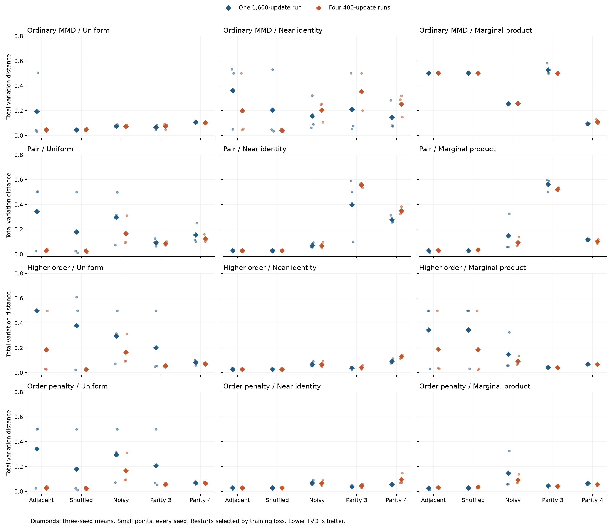

# Initialization changes the optimization result

Small random starts near the all-zero state substantially improved the order-penalized loss on these six-bit tasks. With one 1,600-update run, mean TVD fell from 0.3429 to 0.0269 on adjacent pairs and from 0.2067 to 0.0374 on three-bit parity. The data, circuit, loss and update budget were unchanged. This supports initialization sensitivity as an explanation for several earlier poor fits, although the effect depends on the loss and target.

The [frozen protocol](initialization-restarts-protocol.md) compares three initialization families and two allocations of the same 1,600 gradient updates. It retains all 900 candidate fits across 360 policies, five targets and three dataset seeds. Every gradient is deterministic and fully enumerated. Restart selection uses only the final empirical training loss; target and held-out metrics are computed afterward.

## The order-penalized comparison

Values below are mean exact total variation distance, where lower is better. Each cell contains three dataset seeds. The classical reference uses the same order-penalized selected features, but its capacity and optimizer costs are not matched to the circuit.

| Target | Uniform, single | Uniform, four starts | Near identity, single | Near identity, four starts | Selected classical |
|---|---:|---:|---:|---:|---:|
| Adjacent pairs | 0.3429 | 0.0282 | 0.0269 | 0.0269 | 0.0270 |
| Shuffled pairs | 0.1786 | 0.0242 | 0.0269 | 0.0269 | 0.0270 |
| Noisy pairs | 0.2951 | 0.1659 | 0.0678 | 0.0664 | 0.0392 |
| Three-bit parity | 0.2067 | 0.0574 | 0.0374 | 0.0434 | 0.0468 |
| Four-bit parity | 0.0684 | 0.0655 | 0.0545 | 0.0948 | 0.0600 |

The near-identity single runs had TVD ranges of 0.0163–0.0333 for both clean pair tasks, 0.0534–0.0919 for noisy pairs, 0.0296–0.0441 for three-bit parity and 0.0492–0.0582 for four-bit parity. These ranges include every seed. The lower parity means than the selected classical reference are observations on three synthetic datasets, not evidence of a computational advantage.

The uniform single runs sometimes ended near stationary points with large distribution errors. For example, seed 137 on adjacent pairs had TVD 0.5000 and final gradient norm about 0.000002. Its near-identity counterpart reached TVD 0.0163. A small gradient alone therefore does not establish a good fit. The experiment does not certify a local or global minimum.

## More starts do not always help

Across all 180 restart-minus-single comparisons, TVD improved in 89, worsened in 89 and differed by at most 1e-8 in two. Some large improvements from poor single starts brought the mean difference to -0.0455. These comparisons share data and include closely related losses; they are not 180 independent trials or an estimate of future success probability.

Restarts lowered final training loss by more than 1e-8 in 78 comparisons. In 30 of those, target TVD increased by more than 1e-8. The selection rule worked as specified, but a lower empirical objective did not always mean a better population distribution. All candidates remain available in the [summary](initialization-restarts-summary.json); no evaluation-selected candidate is substituted for the training-selected result.

Uniform starts benefited most clearly under higher-order weighting. Mean TVD fell from 0.3783 to 0.0253 on shuffled pairs and from 0.2016 to 0.0563 on three-bit parity. One adjacent-pair seed still had TVD 0.4982 after restart selection, leaving that condition's mean at 0.1855.

Near-identity starts already gave good single-run results under order-penalized weighting. Dividing their budget across four starts raised mean four-bit parity TVD from 0.0545 to 0.0948. Each restart has only 400 updates and a learning-rate schedule over those 400 updates, so this comparison changes both exploration and the optimization time available to each candidate.

## Initialization and loss interact

The near-identity result does not extend to every loss. With ordinary MMD and a single start, near-identity mean TVD was 0.3607 on adjacent pairs and 0.2096 on three-bit parity. The corresponding order-penalized values were 0.0269 and 0.0374. Pair weighting alone also remained poor on three-bit parity, with near-identity mean TVD 0.3970.

Starting near the fitted independent product distribution was not a general remedy. Under ordinary MMD, its single-run means were 0.5022 on adjacent pairs, 0.5016 on shuffled pairs and 0.5280 on three-bit parity. With order-penalized weighting, the same initialization family reached 0.0258, 0.0286 and 0.0438. These starts use training marginals only, and their perturbations were fixed before collecting outcomes.

Diamonds show three-seed means; small points show each selected policy result. The [complete tables](initialization-restarts-tables.md) include all configurations, seven learned classical controls and every paired seed difference. The comparisons discussed here do not define a new winner-selection policy from evaluation results.

## Resources and verification

Each policy uses 1,600 gradient updates and 6,553,600 classical training phase evaluations. Initial and final objective diagnostics bring the totals to 6,561,792 for one start and 6,586,368 for four starts. The restart policy's extra diagnostic cost is 0.375% of the common training budget. Selection reuses the final diagnostic scores and adds no objective calls.

All 900 candidates receive exact Qiskit evaluation and 2,048 simulator samples, including candidates that were not selected. The four-start policy therefore also uses more evaluation work. No training shots or physical hardware were used. The preflight used arbitrary data, one worker and one BLAS thread; its memory figure measures traced Python/NumPy allocations rather than total process memory.

The [archive](../results/initialization-restarts-v1/) preserves the configuration, protocol, lockfile, source, data, starting vectors, optimizer histories, samples and original classical reference records. Its audit checks all 360 policies and 900 candidates, replays all 900 fits, and reproduces 120 previously published fits. The [source-replay receipt](verification/initialization-restarts-v1-replay.json) records exact agreement for all 15 records except elapsed-time fields in the recorded Windows environment. Previous experiment snapshots remain unchanged.

## What this leaves open

Initialization and loss must be considered together when interpreting these optimization failures. Target expressibility and deterministic gradients did not make the earlier uniform starts reliable, while a different fixed initialization recovered much better fits on several tasks. These results do not establish optimizer optimality, quantum advantage or behavior at larger widths.

A useful next test is an untouched seed replication with the same initialization scales, losses and allocation rules. It should preserve all three initialization families and both allocations, with the order-penalized near-identity comparison declared in advance as the main question. That would test whether the observed improvement survives new training samples and starting draws without tuning the policy to this study.
