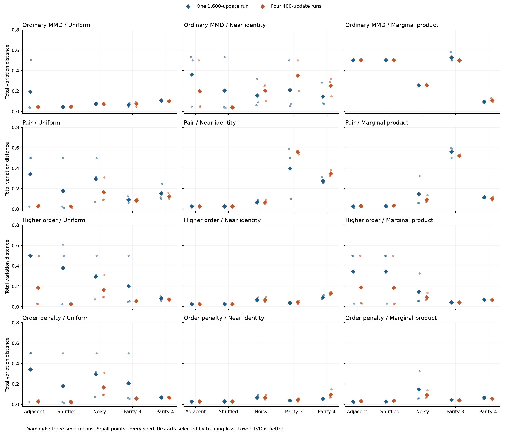

# Initialization and restarts: complete tables

Values are mean exact TVD over seeds 42, 137 and 2026. Every policy uses 1,600 gradient updates. The [protocol](initialization-restarts-protocol.md) fixes the starts and training-only selection rule. The [summary JSON](initialization-restarts-summary.json) contains all 360 selected policies, all 900 candidates, secondary metrics and every paired difference.

## Uniform, restarts

| Condition | Ordinary MMD | Pair | Higher order | Order penalty |
|---|---:|---:|---:|---:|
| Adjacent pairs | 0.0443 | 0.0282 | 0.1855 | 0.0282 |
| Shuffled pairs | 0.0469 | 0.0242 | 0.0253 | 0.0242 |
| Noisy pairs | 0.0731 | 0.1659 | 0.1659 | 0.1659 |
| Three-bit parity | 0.0740 | 0.0858 | 0.0563 | 0.0574 |
| Four-bit parity | 0.1017 | 0.1260 | 0.0704 | 0.0655 |

## Uniform, single

| Condition | Ordinary MMD | Pair | Higher order | Order penalty |
|---|---:|---:|---:|---:|
| Adjacent pairs | 0.1926 | 0.3429 | 0.5000 | 0.3429 |
| Shuffled pairs | 0.0443 | 0.1786 | 0.3783 | 0.1786 |
| Noisy pairs | 0.0753 | 0.2951 | 0.2951 | 0.2951 |
| Three-bit parity | 0.0659 | 0.0921 | 0.2016 | 0.2067 |
| Four-bit parity | 0.1071 | 0.1546 | 0.0830 | 0.0684 |

## Near identity, restarts

| Condition | Ordinary MMD | Pair | Higher order | Order penalty |
|---|---:|---:|---:|---:|
| Adjacent pairs | 0.1993 | 0.0269 | 0.0269 | 0.0269 |
| Shuffled pairs | 0.0394 | 0.0269 | 0.0269 | 0.0269 |
| Noisy pairs | 0.2035 | 0.0664 | 0.0664 | 0.0664 |
| Three-bit parity | 0.3520 | 0.5571 | 0.0435 | 0.0434 |
| Four-bit parity | 0.2519 | 0.3488 | 0.1305 | 0.0948 |

## Near identity, single

| Condition | Ordinary MMD | Pair | Higher order | Order penalty |
|---|---:|---:|---:|---:|
| Adjacent pairs | 0.3607 | 0.0269 | 0.0269 | 0.0269 |
| Shuffled pairs | 0.2044 | 0.0269 | 0.0269 | 0.0269 |
| Noisy pairs | 0.1571 | 0.0678 | 0.0678 | 0.0678 |
| Three-bit parity | 0.2096 | 0.3970 | 0.0373 | 0.0374 |
| Four-bit parity | 0.1455 | 0.2772 | 0.0927 | 0.0545 |

## Marginal product, restarts

| Condition | Ordinary MMD | Pair | Higher order | Order penalty |
|---|---:|---:|---:|---:|
| Adjacent pairs | 0.5027 | 0.0305 | 0.1894 | 0.0305 |
| Shuffled pairs | 0.5023 | 0.0343 | 0.1849 | 0.0343 |
| Noisy pairs | 0.2567 | 0.0921 | 0.0921 | 0.0921 |
| Three-bit parity | 0.5006 | 0.5224 | 0.0407 | 0.0407 |
| Four-bit parity | 0.1095 | 0.1021 | 0.0663 | 0.0557 |

## Marginal product, single

| Condition | Ordinary MMD | Pair | Higher order | Order penalty |
|---|---:|---:|---:|---:|
| Adjacent pairs | 0.5022 | 0.0258 | 0.3437 | 0.0258 |
| Shuffled pairs | 0.5016 | 0.0286 | 0.3437 | 0.0286 |
| Noisy pairs | 0.2560 | 0.1466 | 0.1466 | 0.1466 |
| Three-bit parity | 0.5280 | 0.5624 | 0.0429 | 0.0438 |
| Four-bit parity | 0.0947 | 0.1164 | 0.0676 | 0.0639 |

## Classical references

These learned models use the same data; their capacities and optimizer costs are not matched to the circuit fits. The oracle has TVD zero and is not a learned model.

| Condition | Empirical | Independent | Pairwise | Autoregressive | Higher-order selected | Order-4 | Order-penalized selected |
|---|---:|---:|---:|---:|---:|---:|---:|
| Adjacent pairs | 0.0449 | 0.8745 | 0.0481 | 0.0487 | 0.0270 | 0.0450 | 0.0270 |
| Shuffled pairs | 0.0449 | 0.8745 | 0.0481 | 0.0471 | 0.0270 | 0.0450 | 0.0270 |
| Noisy pairs | 0.0917 | 0.6038 | 0.0635 | 0.0664 | 0.0392 | 0.0911 | 0.0392 |
| Three-bit parity | 0.0612 | 0.7500 | 0.7480 | 0.0668 | 0.0468 | 0.0615 | 0.0468 |
| Four-bit parity | 0.0944 | 0.5000 | 0.4977 | 0.0838 | 0.0658 | 0.0945 | 0.0600 |

## Restart minus single differences

Negative values favor the first policy. Differences are paired on dataset seed, loss and the settings not being varied.

| Condition | Loss | Initialization | Allocation | Seed 42 | Seed 137 | Seed 2026 |
|---|---|---|---|---:|---:|---:|
| Adjacent pairs | Higher order | Marginal product | restarts | -0.0000 | -0.4629 | -0.0001 |
| Adjacent pairs | Higher order | Near identity | restarts | +0.0000 | +0.0000 | +0.0000 |
| Adjacent pairs | Higher order | Uniform | restarts | -0.4698 | -0.4719 | -0.0018 |
| Adjacent pairs | Ordinary MMD | Marginal product | restarts | +0.0007 | +0.0005 | +0.0004 |
| Adjacent pairs | Ordinary MMD | Near identity | restarts | -0.0339 | -0.0051 | -0.4450 |
| Adjacent pairs | Ordinary MMD | Uniform | restarts | +0.0071 | +0.0095 | -0.4617 |
| Adjacent pairs | Order penalty | Marginal product | restarts | +0.0046 | +0.0001 | +0.0095 |
| Adjacent pairs | Order penalty | Near identity | restarts | -0.0000 | +0.0000 | +0.0000 |
| Adjacent pairs | Order penalty | Uniform | restarts | +0.0005 | -0.4804 | -0.4642 |
| Adjacent pairs | Pair | Marginal product | restarts | +0.0046 | +0.0001 | +0.0095 |
| Adjacent pairs | Pair | Near identity | restarts | -0.0000 | +0.0000 | +0.0000 |
| Adjacent pairs | Pair | Uniform | restarts | +0.0005 | -0.4804 | -0.4642 |
| Noisy pairs | Higher order | Marginal product | restarts | +0.0097 | +0.0154 | -0.1886 |
| Noisy pairs | Higher order | Near identity | restarts | -0.0015 | -0.0050 | +0.0023 |
| Noisy pairs | Higher order | Uniform | restarts | +0.0203 | -0.2200 | -0.1880 |
| Noisy pairs | Ordinary MMD | Marginal product | restarts | +0.0022 | -0.0000 | -0.0000 |
| Noisy pairs | Ordinary MMD | Near identity | restarts | +0.1876 | -0.0645 | +0.0160 |
| Noisy pairs | Ordinary MMD | Uniform | restarts | +0.0002 | -0.0062 | -0.0005 |
| Noisy pairs | Order penalty | Marginal product | restarts | +0.0097 | +0.0154 | -0.1886 |
| Noisy pairs | Order penalty | Near identity | restarts | -0.0015 | -0.0050 | +0.0023 |
| Noisy pairs | Order penalty | Uniform | restarts | +0.0203 | -0.2200 | -0.1880 |
| Noisy pairs | Pair | Marginal product | restarts | +0.0097 | +0.0154 | -0.1886 |
| Noisy pairs | Pair | Near identity | restarts | -0.0015 | -0.0050 | +0.0023 |
| Noisy pairs | Pair | Uniform | restarts | +0.0203 | -0.2200 | -0.1880 |
| Three-bit parity | Higher order | Marginal product | restarts | +0.0002 | +0.0001 | -0.0071 |
| Three-bit parity | Higher order | Near identity | restarts | -0.0002 | -0.0015 | +0.0200 |
| Three-bit parity | Higher order | Uniform | restarts | -0.0048 | -0.4322 | +0.0011 |
| Three-bit parity | Ordinary MMD | Marginal product | restarts | -0.0824 | -0.0000 | +0.0001 |
| Three-bit parity | Ordinary MMD | Near identity | restarts | -0.1442 | +0.4475 | +0.1240 |
| Three-bit parity | Ordinary MMD | Uniform | restarts | +0.0241 | -0.0000 | +0.0002 |
| Three-bit parity | Order penalty | Marginal product | restarts | -0.0023 | +0.0001 | -0.0071 |
| Three-bit parity | Order penalty | Near identity | restarts | -0.0003 | -0.0015 | +0.0200 |
| Three-bit parity | Order penalty | Uniform | restarts | -0.0167 | -0.4322 | +0.0011 |
| Three-bit parity | Pair | Marginal product | restarts | -0.0813 | +0.0141 | -0.0527 |
| Three-bit parity | Pair | Near identity | restarts | -0.0228 | +0.0679 | +0.4354 |
| Three-bit parity | Pair | Uniform | restarts | -0.0393 | +0.0072 | +0.0130 |
| Four-bit parity | Higher order | Marginal product | restarts | -0.0022 | +0.0003 | -0.0021 |
| Four-bit parity | Higher order | Near identity | restarts | +0.0371 | +0.0475 | +0.0290 |
| Four-bit parity | Higher order | Uniform | restarts | -0.0213 | -0.0001 | -0.0163 |
| Four-bit parity | Ordinary MMD | Marginal product | restarts | +0.0421 | +0.0047 | -0.0023 |
| Four-bit parity | Ordinary MMD | Near identity | restarts | +0.0062 | +0.2386 | +0.0747 |
| Four-bit parity | Ordinary MMD | Uniform | restarts | -0.0000 | -0.0162 | -0.0000 |
| Four-bit parity | Order penalty | Marginal product | restarts | +0.0043 | -0.0157 | -0.0133 |
| Four-bit parity | Order penalty | Near identity | restarts | +0.0117 | +0.0204 | +0.0887 |
| Four-bit parity | Order penalty | Uniform | restarts | +0.0006 | -0.0085 | -0.0007 |
| Four-bit parity | Pair | Marginal product | restarts | -0.0037 | -0.0393 | +0.0001 |
| Four-bit parity | Pair | Near identity | restarts | +0.0093 | +0.1254 | +0.0802 |
| Four-bit parity | Pair | Uniform | restarts | +0.0454 | +0.0007 | -0.1319 |
| Shuffled pairs | Higher order | Marginal product | restarts | -0.0000 | -0.4762 | -0.0002 |
| Shuffled pairs | Higher order | Near identity | restarts | +0.0000 | -0.0000 | +0.0000 |
| Shuffled pairs | Higher order | Uniform | restarts | -0.0003 | -0.5904 | -0.4682 |
| Shuffled pairs | Ordinary MMD | Marginal product | restarts | +0.0007 | +0.0000 | +0.0013 |
| Shuffled pairs | Ordinary MMD | Near identity | restarts | +0.0042 | -0.4977 | -0.0015 |
| Shuffled pairs | Ordinary MMD | Uniform | restarts | -0.0013 | -0.0000 | +0.0092 |
| Shuffled pairs | Order penalty | Marginal product | restarts | +0.0002 | +0.0000 | +0.0169 |
| Shuffled pairs | Order penalty | Near identity | restarts | -0.0000 | -0.0000 | +0.0000 |
| Shuffled pairs | Order penalty | Uniform | restarts | +0.0089 | -0.4717 | -0.0002 |
| Shuffled pairs | Pair | Marginal product | restarts | +0.0002 | +0.0000 | +0.0169 |
| Shuffled pairs | Pair | Near identity | restarts | -0.0000 | -0.0000 | +0.0000 |
| Shuffled pairs | Pair | Uniform | restarts | +0.0089 | -0.4717 | -0.0002 |

## Initialization minus uniform differences

Negative values favor the first policy. Differences are paired on dataset seed, loss and the settings not being varied.

| Condition | Loss | Initialization | Allocation | Seed 42 | Seed 137 | Seed 2026 |
|---|---|---|---|---:|---:|---:|
| Adjacent pairs | Higher order | Marginal product | restarts | +0.4698 | +0.0090 | -0.4672 |
| Adjacent pairs | Higher order | Marginal product | single | +0.0000 | -0.0000 | -0.4688 |
| Adjacent pairs | Higher order | Near identity | restarts | +0.0031 | -0.0118 | -0.4670 |
| Adjacent pairs | Higher order | Near identity | single | -0.4667 | -0.4837 | -0.4688 |
| Adjacent pairs | Ordinary MMD | Marginal product | restarts | +0.4545 | +0.4587 | +0.4621 |
| Adjacent pairs | Ordinary MMD | Marginal product | single | +0.4610 | +0.4677 | +0.0000 |
| Adjacent pairs | Ordinary MMD | Near identity | restarts | +0.4515 | +0.0005 | +0.0132 |
| Adjacent pairs | Ordinary MMD | Near identity | single | +0.4925 | +0.0151 | -0.0035 |
| Adjacent pairs | Order penalty | Marginal product | restarts | +0.0091 | +0.0168 | -0.0189 |
| Adjacent pairs | Order penalty | Marginal product | single | +0.0049 | -0.4637 | -0.4926 |
| Adjacent pairs | Order penalty | Near identity | restarts | +0.0080 | -0.0033 | -0.0084 |
| Adjacent pairs | Order penalty | Near identity | single | +0.0084 | -0.4837 | -0.4726 |
| Adjacent pairs | Pair | Marginal product | restarts | +0.0091 | +0.0168 | -0.0189 |
| Adjacent pairs | Pair | Marginal product | single | +0.0049 | -0.4637 | -0.4926 |
| Adjacent pairs | Pair | Near identity | restarts | +0.0080 | -0.0033 | -0.0084 |
| Adjacent pairs | Pair | Near identity | single | +0.0084 | -0.4837 | -0.4726 |
| Noisy pairs | Higher order | Marginal product | restarts | -0.0257 | -0.0214 | -0.1742 |
| Noisy pairs | Higher order | Marginal product | single | -0.0151 | -0.2568 | -0.1736 |
| Noisy pairs | Higher order | Near identity | restarts | -0.0355 | -0.0465 | -0.2165 |
| Noisy pairs | Higher order | Near identity | single | -0.0136 | -0.2614 | -0.4068 |
| Noisy pairs | Ordinary MMD | Marginal product | restarts | +0.1875 | +0.1934 | +0.1701 |
| Noisy pairs | Ordinary MMD | Marginal product | single | +0.1855 | +0.1871 | +0.1696 |
| Noisy pairs | Ordinary MMD | Near identity | restarts | +0.1780 | +0.1934 | +0.0199 |
| Noisy pairs | Ordinary MMD | Near identity | single | -0.0094 | +0.2516 | +0.0034 |
| Noisy pairs | Order penalty | Marginal product | restarts | -0.0257 | -0.0214 | -0.1742 |
| Noisy pairs | Order penalty | Marginal product | single | -0.0151 | -0.2568 | -0.1736 |
| Noisy pairs | Order penalty | Near identity | restarts | -0.0355 | -0.0465 | -0.2165 |
| Noisy pairs | Order penalty | Near identity | single | -0.0136 | -0.2614 | -0.4068 |
| Noisy pairs | Pair | Marginal product | restarts | -0.0257 | -0.0214 | -0.1742 |
| Noisy pairs | Pair | Marginal product | single | -0.0151 | -0.2568 | -0.1736 |
| Noisy pairs | Pair | Near identity | restarts | -0.0355 | -0.0465 | -0.2165 |
| Noisy pairs | Pair | Near identity | single | -0.0136 | -0.2614 | -0.4068 |
| Three-bit parity | Higher order | Marginal product | restarts | -0.0019 | -0.0286 | -0.0162 |
| Three-bit parity | Higher order | Marginal product | single | -0.0070 | -0.4609 | -0.0080 |
| Three-bit parity | Higher order | Near identity | restarts | -0.0022 | -0.0397 | +0.0034 |
| Three-bit parity | Higher order | Near identity | single | -0.0068 | -0.4704 | -0.0154 |
| Three-bit parity | Ordinary MMD | Marginal product | restarts | +0.4094 | +0.4535 | +0.4170 |
| Three-bit parity | Ordinary MMD | Marginal product | single | +0.5160 | +0.4535 | +0.4171 |
| Three-bit parity | Ordinary MMD | Near identity | restarts | +0.2648 | +0.4532 | +0.1161 |
| Three-bit parity | Ordinary MMD | Near identity | single | +0.4331 | +0.0056 | -0.0077 |
| Three-bit parity | Order penalty | Marginal product | restarts | -0.0054 | -0.0286 | -0.0162 |
| Three-bit parity | Order penalty | Marginal product | single | -0.0198 | -0.4609 | -0.0080 |
| Three-bit parity | Order penalty | Near identity | restarts | -0.0057 | -0.0397 | +0.0034 |
| Three-bit parity | Order penalty | Near identity | single | -0.0220 | -0.4704 | -0.0154 |
| Three-bit parity | Pair | Marginal product | restarts | +0.4302 | +0.4450 | +0.4348 |
| Three-bit parity | Pair | Marginal product | single | +0.4721 | +0.4381 | +0.5005 |
| Three-bit parity | Pair | Near identity | restarts | +0.4806 | +0.4998 | +0.4336 |
| Three-bit parity | Pair | Near identity | single | +0.4641 | +0.4392 | +0.0112 |
| Four-bit parity | Higher order | Marginal product | restarts | -0.0090 | +0.0011 | -0.0045 |
| Four-bit parity | Higher order | Marginal product | single | -0.0281 | +0.0007 | -0.0188 |
| Four-bit parity | Higher order | Near identity | restarts | +0.0336 | +0.0754 | +0.0714 |
| Four-bit parity | Higher order | Near identity | single | -0.0248 | +0.0278 | +0.0261 |
| Four-bit parity | Ordinary MMD | Marginal product | restarts | +0.0260 | +0.0057 | -0.0084 |
| Four-bit parity | Ordinary MMD | Marginal product | single | -0.0161 | -0.0152 | -0.0061 |
| Four-bit parity | Ordinary MMD | Near identity | restarts | +0.1847 | +0.2222 | +0.0438 |
| Four-bit parity | Ordinary MMD | Near identity | single | +0.1785 | -0.0327 | -0.0309 |
| Four-bit parity | Order penalty | Marginal product | restarts | -0.0176 | -0.0124 | +0.0006 |
| Four-bit parity | Order penalty | Marginal product | single | -0.0213 | -0.0052 | +0.0131 |
| Four-bit parity | Order penalty | Near identity | restarts | -0.0071 | +0.0064 | +0.0884 |
| Four-bit parity | Order penalty | Near identity | single | -0.0181 | -0.0224 | -0.0011 |
| Four-bit parity | Pair | Marginal product | restarts | -0.0546 | -0.0172 | -0.0001 |
| Four-bit parity | Pair | Marginal product | single | -0.0055 | +0.0228 | -0.1320 |
| Four-bit parity | Pair | Near identity | restarts | +0.1624 | +0.2816 | +0.2243 |
| Four-bit parity | Pair | Near identity | single | +0.1985 | +0.1568 | +0.0122 |
| Shuffled pairs | Higher order | Marginal product | restarts | +0.4755 | +0.0041 | -0.0008 |
| Shuffled pairs | Higher order | Marginal product | single | +0.4752 | -0.1101 | -0.4688 |
| Shuffled pairs | Higher order | Near identity | restarts | +0.0088 | -0.0033 | -0.0006 |
| Shuffled pairs | Higher order | Near identity | single | +0.0085 | -0.5936 | -0.4688 |
| Shuffled pairs | Ordinary MMD | Marginal product | restarts | +0.4623 | +0.4575 | +0.4463 |
| Shuffled pairs | Ordinary MMD | Marginal product | single | +0.4602 | +0.4575 | +0.4542 |
| Shuffled pairs | Ordinary MMD | Near identity | restarts | +0.0113 | -0.0088 | -0.0249 |
| Shuffled pairs | Ordinary MMD | Near identity | single | +0.0058 | +0.4889 | -0.0142 |
| Shuffled pairs | Order penalty | Marginal product | restarts | -0.0037 | +0.0046 | +0.0294 |
| Shuffled pairs | Order penalty | Marginal product | single | +0.0050 | -0.4672 | +0.0122 |
| Shuffled pairs | Order penalty | Near identity | restarts | -0.0004 | -0.0120 | +0.0206 |
| Shuffled pairs | Order penalty | Near identity | single | +0.0085 | -0.4837 | +0.0203 |
| Shuffled pairs | Pair | Marginal product | restarts | -0.0037 | +0.0046 | +0.0294 |
| Shuffled pairs | Pair | Marginal product | single | +0.0050 | -0.4672 | +0.0122 |
| Shuffled pairs | Pair | Near identity | restarts | -0.0004 | -0.0120 | +0.0206 |
| Shuffled pairs | Pair | Near identity | single | +0.0085 | -0.4837 | +0.0203 |

## Verification

The audit checked 360 policies and 900 candidates, replayed 900 fits and reproduced 120 published fits. The single and restart policies use 6,561,792 and 6,586,368 phase evaluations including objective diagnostics. All candidates receive 2,048 evaluation samples; this evaluation work is separate from training.
