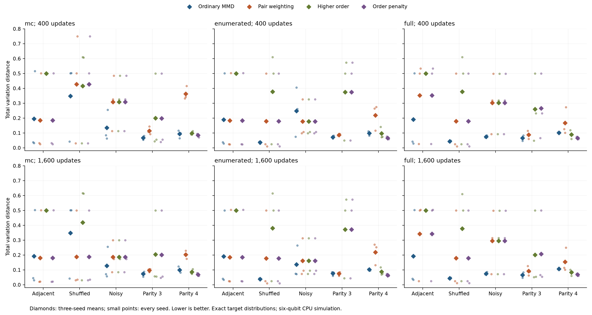

# Observable diagnostics: complete tables

This supplement reports every configuration from the [frozen protocol](observable-diagnostics-protocol.md). Values are three-seed mean TVD. The [summary JSON](observable-diagnostics-summary.json) retains every seed, secondary metric, final gradient norm and paired difference.

## mc, 400 updates

| Condition | Ordinary MMD | Pair | Higher order | Order penalty |
|---|---:|---:|---:|---:|
| Adjacent pairs | 0.1950 | 0.1856 | 0.5001 | 0.1856 |
| Shuffled pairs | 0.3484 | 0.4274 | 0.4162 | 0.4274 |
| Noisy pairs | 0.1346 | 0.3082 | 0.3082 | 0.3082 |
| Three-bit parity | 0.0666 | 0.1143 | 0.1999 | 0.1985 |
| Four-bit parity | 0.0936 | 0.3635 | 0.0978 | 0.0843 |

## mc, 1,600 updates

| Condition | Ordinary MMD | Pair | Higher order | Order penalty |
|---|---:|---:|---:|---:|
| Adjacent pairs | 0.1928 | 0.1810 | 0.5001 | 0.1810 |
| Shuffled pairs | 0.3483 | 0.1883 | 0.4195 | 0.1883 |
| Noisy pairs | 0.1283 | 0.1860 | 0.1860 | 0.1860 |
| Three-bit parity | 0.0729 | 0.0974 | 0.2040 | 0.2006 |
| Four-bit parity | 0.0996 | 0.2033 | 0.0862 | 0.0686 |

## enumerated, 400 updates

| Condition | Ordinary MMD | Pair | Higher order | Order penalty |
|---|---:|---:|---:|---:|
| Adjacent pairs | 0.1890 | 0.1837 | 0.5000 | 0.1837 |
| Shuffled pairs | 0.0363 | 0.1784 | 0.3781 | 0.1784 |
| Noisy pairs | 0.2476 | 0.1772 | 0.1772 | 0.1772 |
| Three-bit parity | 0.0715 | 0.0860 | 0.3743 | 0.3745 |
| Four-bit parity | 0.0976 | 0.2180 | 0.0960 | 0.0658 |

## enumerated, 1,600 updates

| Condition | Ordinary MMD | Pair | Higher order | Order penalty |
|---|---:|---:|---:|---:|
| Adjacent pairs | 0.1914 | 0.1843 | 0.5000 | 0.1843 |
| Shuffled pairs | 0.0385 | 0.1784 | 0.3800 | 0.1784 |
| Noisy pairs | 0.1368 | 0.1608 | 0.1608 | 0.1608 |
| Three-bit parity | 0.0755 | 0.0749 | 0.3724 | 0.3724 |
| Four-bit parity | 0.1020 | 0.2184 | 0.0873 | 0.0648 |

## full, 400 updates

| Condition | Ordinary MMD | Pair | Higher order | Order penalty |
|---|---:|---:|---:|---:|
| Adjacent pairs | 0.1906 | 0.3529 | 0.5000 | 0.3529 |
| Shuffled pairs | 0.0437 | 0.1785 | 0.3782 | 0.1785 |
| Noisy pairs | 0.0749 | 0.3032 | 0.3032 | 0.3032 |
| Three-bit parity | 0.0659 | 0.0874 | 0.2600 | 0.2658 |
| Four-bit parity | 0.1017 | 0.1670 | 0.0890 | 0.0655 |

## full, 1,600 updates

| Condition | Ordinary MMD | Pair | Higher order | Order penalty |
|---|---:|---:|---:|---:|
| Adjacent pairs | 0.1926 | 0.3429 | 0.5000 | 0.3429 |
| Shuffled pairs | 0.0443 | 0.1786 | 0.3783 | 0.1786 |
| Noisy pairs | 0.0753 | 0.2951 | 0.2951 | 0.2951 |
| Three-bit parity | 0.0659 | 0.0921 | 0.2016 | 0.2067 |
| Four-bit parity | 0.1071 | 0.1546 | 0.0830 | 0.0684 |

## Learned classical references

The seven learned references use the same data. Optimizer costs and capacities are not matched to IQP. The oracle, omitted here, has TVD zero.

| Condition | Empirical | Independent | Pairwise | Autoregressive | Higher-order selected | Order-4 | Order-penalized selected |
|---|---:|---:|---:|---:|---:|---:|---:|
| Adjacent pairs | 0.0449 | 0.8745 | 0.0481 | 0.0487 | 0.0270 | 0.0450 | 0.0270 |
| Shuffled pairs | 0.0449 | 0.8745 | 0.0481 | 0.0471 | 0.0270 | 0.0450 | 0.0270 |
| Noisy pairs | 0.0917 | 0.6038 | 0.0635 | 0.0664 | 0.0392 | 0.0911 | 0.0392 |
| Three-bit parity | 0.0612 | 0.7500 | 0.7480 | 0.0668 | 0.0468 | 0.0615 | 0.0468 |
| Four-bit parity | 0.0944 | 0.5000 | 0.4977 | 0.0838 | 0.0658 | 0.0945 | 0.0600 |

## Verification

The audit checked 480 circuit/classical/reference distributions, reproduced 90 published short-budget fits exactly apart from elapsed times, and replayed 360 new-series Adam fits. No fit was selected by evaluation performance.
