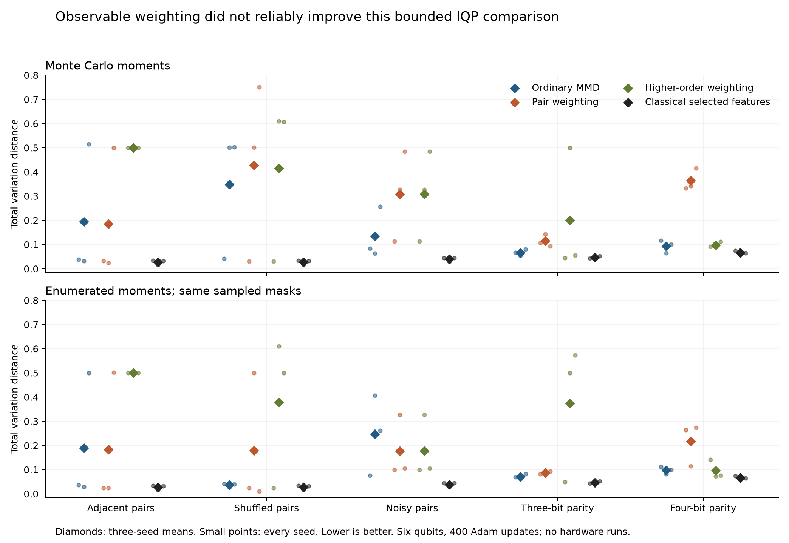

# Observable weighting: bounded generalization test

11 November 2026. Five synthetic six-bit conditions, three seeds, 90 circuit fits and 90 learned classical fits, with 15 oracle references. All execution used local classical hardware and Qiskit simulation.

Learned weighting did not reliably improve distributional fidelity in this comparison. Higher-order weighting worsened mean Monte Carlo TVD on both clean-pair conditions, noisy pairs and three-bit parity. On four-bit parity, its mean was close to ordinary MMD. The classical maximum-entropy model using the same selected features had lower mean TVD than every IQP variant in all five conditions.

These results qualify the earlier 32-qubit adjacent-pair result. They do not refute that result: this experiment uses a dense six-qubit circuit, a shorter optimizer schedule, and a different higher-order selector. It establishes neither quantum advantage nor a general failure of observable weighting.



## Exact distributional fidelity

TVD ranges from zero for an exact match to one for disjoint support. Tables show three-seed means. All seeds, secondary metrics and signed paired differences are in the [machine-readable summary](observable-generalization-summary.json).

| Condition | MC: ordinary | MC: pair | MC: higher order | Classical selected features |
|---|---:|---:|---:|---:|
| Adjacent pairs | 0.1950 | 0.1856 | 0.5001 | 0.0270 |
| Shuffled pairs | 0.3484 | 0.4274 | 0.4162 | 0.0270 |
| Noisy pairs | 0.1346 | 0.3082 | 0.3082 | 0.0392 |
| Three-bit parity | 0.0666 | 0.1143 | 0.1999 | 0.0468 |
| Four-bit parity | 0.0936 | 0.3635 | 0.0978 | 0.0658 |

## Moment-estimation control

Both versions use identical initial angles, data, sampled masks and Adam schedules. Enumerating all 64 uniform strings removes moment-estimation noise; mask-sampling noise remains. The control costs half as many phase evaluations here. It is not a fully deterministic-gradient comparison.

| Condition | Enumerated: ordinary | Enumerated: pair | Enumerated: higher order |
|---|---:|---:|---:|
| Adjacent pairs | 0.1890 | 0.1837 | 0.5000 |
| Shuffled pairs | 0.0363 | 0.1784 | 0.3781 |
| Noisy pairs | 0.2476 | 0.1772 | 0.1772 |
| Three-bit parity | 0.0715 | 0.0860 | 0.3743 |
| Four-bit parity | 0.0976 | 0.2180 | 0.0960 |

Removing moment noise substantially improves ordinary MMD on shuffled pairs, but worsens it on noisy pairs. Higher-order weighting still has poor clean-pair solutions with enumerated moments. Estimator noise therefore does not explain every poor fit, and this comparison does not establish a single cause of the optimizer failures.

## Classical controls

These models use the same training examples. Their capacities and optimization costs are not matched to IQP.

| Condition | Empirical | Independent | Pairwise max-ent | Autoregressive MLP | Selected max-ent | Order-4 max-ent |
|---|---:|---:|---:|---:|---:|---:|
| Adjacent pairs | 0.0449 | 0.8745 | 0.0481 | 0.0487 | 0.0270 | 0.0450 |
| Shuffled pairs | 0.0449 | 0.8745 | 0.0481 | 0.0471 | 0.0270 | 0.0450 |
| Noisy pairs | 0.0917 | 0.6038 | 0.0635 | 0.0664 | 0.0392 | 0.0911 |
| Three-bit parity | 0.0612 | 0.7500 | 0.7480 | 0.0668 | 0.0468 | 0.0615 |
| Four-bit parity | 0.0944 | 0.5000 | 0.4977 | 0.0838 | 0.0658 | 0.0945 |

The selected classical model has nine parameters: six single-bit moments and three selected moments. The full degree-four model has 56 parameters. The oracle uses the known target directly and has TVD zero; it is not a learned comparator.

## What failed, and what the selector learned

All 90 circuit fits completed their fixed 400-update budget. None claims optimizer convergence. All three adjacent-pair runs with higher-order weighting ended near TVD 0.5, under both estimators. Other losses also produced poor seed-specific fits, despite the existence of exact target parameters.

The higher-order score is departure from independent marginals, not a cumulant. On clean pairs it often ranks four-bit products of pair constraints ahead of individual pairs. The GF(2) filter prevents algebraic redundancy but does not force the lowest-order representation. This changes the weighted objective and can change optimization behavior; these results do not isolate that mechanism causally.

On noisy pairs, both selectors choose the same three pairs and yield identical circuit fits. On three- and four-bit parity, the higher-order selector recovers the true block constraints in all seeds. It fills the remaining feature slots with empirical dependencies, so recovering the true constraints alone does not guarantee a better fitted distribution.

The archive retains 3 classical optimizer-limit failures: every noisy-pair fit of the 56-parameter maximum-entropy model reached 300 iterations. The smaller selected model and the remaining classical optimizers reported no convergence warnings. There were no execution exceptions.

Noisy pairs require special care: their correct all-even probability is 0.729. The report evaluates TVD against the corrupted target and saves absolute all-even probability error and each block moment. A clean-pair validity score would prefer the wrong target.

## Paired seed differences

Each entry is weighted-loss TVD minus ordinary-MMD TVD for the same condition, seed and estimator. Negative values favor weighting. Seed order is 42, 137, 2026.

| Condition | Estimator | Pair weighting differences | Higher-order differences |
|---|---|---|---|
| Adjacent pairs | mc | -0.0057, -0.0073, -0.0150 | +0.4623, +0.4685, -0.0154 |
| Adjacent pairs | enumerated | -0.0123, -0.0053, +0.0017 | +0.4626, +0.4709, -0.0004 |
| Shuffled pairs | mc | -0.0105, +0.0003, +0.2473 | -0.0104, +0.1089, +0.1049 |
| Shuffled pairs | enumerated | -0.0166, +0.4722, -0.0294 | -0.0169, +0.5821, +0.4603 |
| Noisy pairs | mc | +0.0291, +0.2631, +0.2288 | +0.0291, +0.2631, +0.2288 |
| Noisy pairs | enumerated | +0.0237, -0.0795, -0.1553 | +0.0237, -0.0795, -0.1553 |
| Three-bit parity | mc | +0.0407, +0.0898, +0.0128 | -0.0222, +0.4464, -0.0243 |
| Three-bit parity | enumerated | +0.0123, +0.0199, +0.0112 | -0.0206, +0.4378, +0.4910 |
| Four-bit parity | mc | +0.2164, +0.2785, +0.3149 | -0.0252, +0.0258, +0.0120 |
| Four-bit parity | enumerated | +0.1531, +0.0329, +0.1752 | +0.0295, -0.0101, -0.0241 |

## Budget, checks and reproduction

The [frozen protocol](observable-generalization-protocol.md) fixes 512 training and 1,024 held-out examples, 21 circuit parameters, 64 masks per update and 400 Adam updates. Each Monte Carlo fit uses two independent 64-string halves: 3,276,800 phase evaluations. Each enumerated-moment control uses 1,638,400. Feature selection adds 7,680 pair character evaluations or 25,600 higher-order character evaluations per dataset. Runtime and all candidate scores are saved separately.

The expressibility construction sets star-edge angles within each block to pi/4, with a single-X rotation for the corrupted parity sector. Both NumPy and Qiskit match each known target to numerical precision. Dense connectivity supports every column permutation. Adjacent and shuffled pairs share latent samples, but initial angles are not permuted between conditions; cross-condition differences therefore cannot be assigned solely to column order.

The audit checked 195 fitted/reference distributions and sampling records and replayed 90 Adam fits. Numerical tests cover target construction, data permutation, selector independence, gradient agreement, shared stochastic masks, classical parity expressibility and rejection of a corrupted metric even after its checksum is updated.

A separate replay loaded the archived package source and repeated every circuit fit, classical fit and sampling call. All 15 complete records matched exactly except elapsed-time fields; the [comparison receipt](verification/observable-generalization-v1-replay.json) records the result. Exact equality was checked in the recorded Windows environment, not across platforms.

The new archive is [observable-generalization-v1](../results/observable-generalization-v1/). The seven published baseline snapshots are unchanged. The original explorer and release report remain scoped to those seven series; this follow-up has its own report and figure.

```bash
uv run --locked --extra dev python -m pytest
uv run --locked python -m qgen.generalization --config config/observable-generalization-v1.json --output artifacts/observable-generalization-new
uv run --locked python -m qgen.generalization_audit --output artifacts/observable-generalization-new --replay
uv run --locked python scripts/replay_generalization.py --snapshot results/observable-generalization-v1 --output artifacts/observable-generalization-replay-new
uv run --locked python scripts/build_generalization_report.py --series results/observable-generalization-v1 --destination docs
```

The runner refuses an existing output directory. It saves the frozen protocol, lockfile, configuration, source snapshot, environment, optimizer histories, sampled counts and checksums. The sampled circuit outputs come from Qiskit Statevector sampling; no physical device was used.

A useful next experiment would separate selector design from optimization sensitivity, using a new frozen protocol. The present results do not justify scaling this higher-order selector to larger widths.
