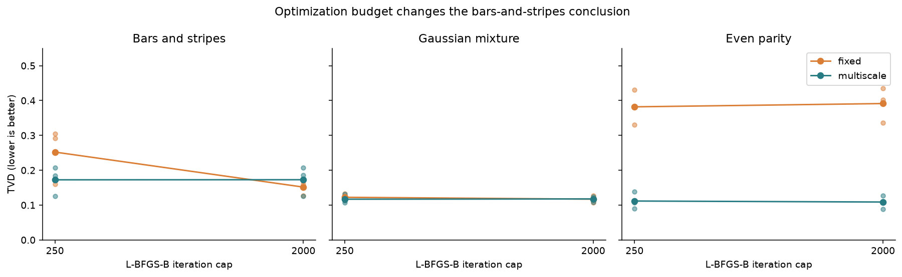
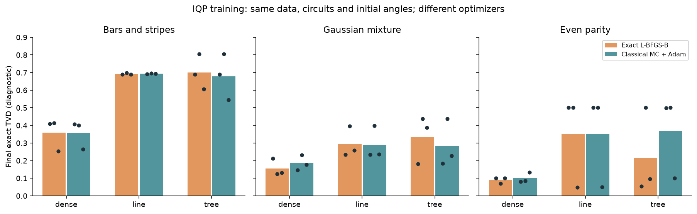
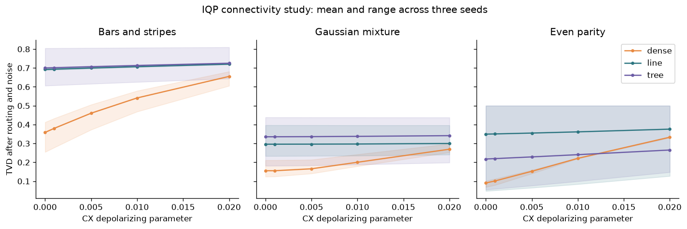
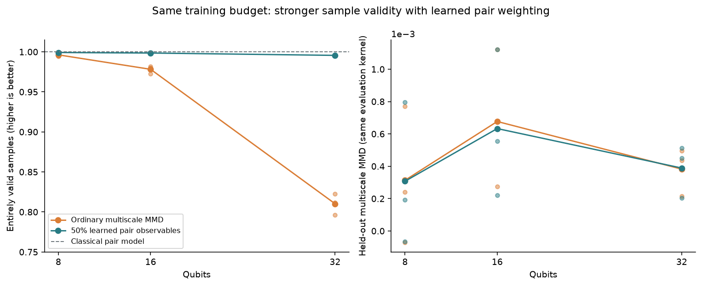

# Quantum generative learning: first release

23 October 2026. Seven experiment series, 153 saved records, three seeds per comparison. All execution used local classical hardware and Qiskit simulators.

The main result is a working classical-training and Qiskit-sampling pipeline, plus a useful correction to its training objective. At 32 qubits, giving extra weight to correlations found in the training data increased fully valid samples from **81.0% to 99.6%** at the same mask and update budgets. The ordinary MMD evaluation score barely changed. On this task, the original loss underweighted the constraints that mattered to sample quality.

The task is deliberately easy for a classical model, which achieves 100% valid samples. This release does not demonstrate quantum advantage. It provides a verified implementation and a bounded experiment that can be extended. Open the [interactive explorer](explorer.html) to inspect individual seeds and simulated noise.

## What was implemented

A circuit Born machine uses the probabilities produced by a parameterized quantum circuit as a generative model. The first stage reproduces that idea on six-bit data with exact simulation and a finite-measurement alternative, following [Liu and Wang](https://arxiv.org/abs/1804.04168) and the loss analysis of [Rudolph et al.](https://www.nature.com/articles/s41534-024-00902-0).

The second stage implements classical training for IQP circuits. Their commuting X-type generators allow output correlations to be estimated from ordinary random bitstrings. Training uses these correlations without a full statevector or quantum training shots. This follows [IQPopt](https://arxiv.org/abs/2501.04776) and [Train on classical, deploy on quantum](https://arxiv.org/abs/2503.02934). The [method notes](iqp-method-notes.md) derive the estimator and fix angle, bit-order and bandwidth conventions.

The project adds a Qiskit connectivity/noise comparison and a follow-up kernel experiment. Adaptive kernels already have [prior art](https://arxiv.org/abs/2510.08476); neither addition is claimed as a new algorithm or a first in the literature.

## Six-qubit results

Each task supplies 512 training examples and 1,024 independent test examples. The known synthetic target is used only for evaluation. Seeds are 42, 137 and 2026. Total variation distance (TVD) is zero for an exact match and one for disjoint distributions. Values below are means, not confidence intervals.

| Model | Bars and stripes | Gaussian mixture | Even parity |
|---|---:|---:|---:|
| Empirical training distribution | 0.0452 | 0.1183 | 0.1009 |
| Independent Bernoulli bits | 0.8433 | 0.4362 | 0.5000 |
| Pairwise maximum entropy | 0.0531 | 0.0976 | 0.5000 |
| Autoregressive MLP | 0.0562 | 0.0992 | 0.1157 |
| QCBM, fixed loss, 2,000-iteration cap | 0.1516 | 0.1170 | 0.3914 |
| QCBM, multiscale loss, 2,000-iteration cap | 0.1728 | 0.1177 | 0.1088 |
| Dense IQP, exact training | 0.3585 | 0.1554 | 0.0905 |
| Dense IQP, classical Monte Carlo training | 0.3569 | 0.1853 | 0.0997 |

Classical models are strong references here. Bars-and-stripes has only ten valid patterns, so 512 samples let an empirical model estimate it well. Even parity diagnoses higher-order dependence: pairwise maximum entropy cannot express its global constraint. A classical generator given that constraint could produce the exact distribution. A small numerical IQP advantage over these particular generic baselines does not establish quantum advantage.

The QCBM has 42 parameters, dense IQP and pairwise maximum entropy have 21, sparse IQP has 11, and the autoregressive MLP has 206. Capacity and hyperparameter-search effort are not equalized.

### An iteration limit changed the conclusion

All 18 initial QCBM fits hit the 250-iteration cap. Raising the cap to 2,000 reversed the bars-and-stripes comparison: fixed-loss TVD improved from 0.2521 to 0.1516, while multiscale remained around 0.173. On parity, multiscale retained a large advantage.

Fifteen of the 18 follow-up fits satisfied the stopping rule. The fixed-loss runs with seed 42 still reached the cap on all three tasks. Stopping-rule success does not prove a global optimum. Both budgets remain in the repository.

### Finite measurements and classical estimates

The Qiskit StatevectorSampler experiment used 100 SPSA updates and 256 or 1,024 measurements per objective call: 51,200 or 204,800 samples per fit. Under the fixed schedule, it learned little. Mean final TVD stayed around 0.85 on bars-and-stripes, 0.53 on the mixture and 0.54 on parity. Increasing shots did not repair this optimizer setup. The result concerns the chosen schedule, not all measurement-based training.

Classical IQP training recovered roughly the exact dense-circuit fit on bars-and-stripes and parity. Mixture performance was worse. Both methods encountered poor sparse-circuit solutions; several parity runs ended near TVD 0.5.

The reference uses L-BFGS-B and the stochastic method uses Adam, so differences cannot be attributed solely to estimator noise. Each Monte Carlo fit used 1,500 updates, 96,000 masks, 768,000 uniform classical bitstrings and 49,152,000 phase evaluations. Quantum training shots were zero. Exact final probabilities were evaluation diagnostics only.

## What survives simulated deployment?

Each trained IQP circuit is routed onto a bidirectional line. Dense circuits have 21 parameters and require 49 CX gates. Line and random-tree circuits each have 11 parameters; their routed counts are 10 and 10-13 CX gates respectively.

| Topology | Bars and stripes: ideal → noisy | Mixture: ideal → noisy | Parity: ideal → noisy |
|---|---:|---:|---:|
| Dense | 0.3585 → 0.6553 | 0.1554 → 0.2695 | 0.0905 → 0.3331 |
| Line | 0.6921 → 0.7203 | 0.2959 → 0.2999 | 0.3493 → 0.3758 |
| Random tree | 0.7002 → 0.7251 | 0.3354 → 0.3413 | 0.2175 → 0.2652 |

The noisy column uses CX depolarizing parameter 0.02; SX/X errors are one tenth as large and RZ gates are ideal. The model excludes readout errors, relaxation and crosstalk, and uses no device calibration.

Sparse circuits require fewer gates but often start with a worse fit. Random trees have the best mean noisy parity result at this error level, with substantial seed variation. This does not establish a reliable topology winner. Dense versus sparse comparisons also change parameter count; only line versus tree holds it fixed.

## Scaling and the kernel follow-up

The larger task consists of independent fair bits repeated in adjacent pairs. At 32 qubits there are 16 independent choices. The circuit includes singleton and all adjacent-pair generators, including edges between the true pairs. Training avoids full statevectors. Qiskit's noiseless matrix product state simulator supplies 2,048 output samples per fit.

The first version reached 98.5% agreement per pair at 32 qubits, yet only 81.0% of complete samples were valid. Small errors accumulated across the sample.

The follow-up selects the `n/2` strongest centered pair correlations from training examples alone. It spends half of each step's mask budget on those observables and half on the original multiscale kernel. Data, initial parameters, optimizer schedule, 1,500 updates and 128 total masks per step stay fixed. Selection adds a small recorded preprocessing cost. The [protocol](pair-priority-protocol.md) was frozen before these runs, after seeing the first version's limitation.

| Qubits | Ordinary MMD: valid samples | Pair-weighted loss: valid samples | Classical pair model |
|---|---:|---:|---:|
| 8 | 99.63% | 99.92% | 100% |
| 16 | 97.82% | 99.85% | 100% |
| 32 | 81.02% | 99.56% | 100% |

At 32 qubits, all seeds improved: 79.64% → 99.51%, 82.28% → 99.56%, and 81.15% → 99.61%. Both objectives use 98,304,000 phase evaluations per fit. The selector receives neither test data nor pair labels, though selecting `n/2` pairs is a task-motivated hyperparameter.

The ordinary held-out multiscale MMD stayed about 0.00038 in both versions, despite the large validity improvement. Inspect sample constraints as well as a kernel score. This does not show that the new loss learns every property of the joint distribution. A collapsed model could also satisfy pair constraints, which is why evaluation retains marginal bias and held-out MMD.

The target and line circuits are classically tractable. The informed classical pair model fits one Bernoulli probability per pair and guarantees valid pairs. Qubit count alone provides no evidence of sampling hardness. Noise tolerance at 32 qubits remains untested.

## Verification and reproducibility

The 31 tests compare Qiskit amplitudes with a matrix exponential, gradients with finite differences, and Fourier losses with full probability-kernel calculations. An exhaustive two-qubit average verifies the independent-pair estimator's unbiased loss and gradient. Tests also cover the learned-pair kernel, permuted columns, bit order and rejection of corrupted records, including under optimized Python.

Each series preserves configuration, data, fitted parameters, package source, dependency versions and result hashes. Audits recompute small-system metrics and Qiskit probabilities. The deep audit replays 135 noisy evaluations. Larger-run audits regenerate the data and classical baselines and replay both initial and trained Qiskit sampling, 36 replays across the two series.

The 27-record `reproduction-v1` series was rerun from its archived source. Every field matched except elapsed times; the [comparison receipt](verification/reproduction-v1-replay.json) records the result. Git attributes preserve archived bytes so line-ending conversion cannot invalidate receipts. The CI workflow runs tests and selected audits on Windows and Linux; its status is available in [GitHub Actions](https://github.com/MostafaAbdelmegeed/quantum-generative-learning/actions/workflows/tests.yml).

The [release summary](release-summary.json) contains every six-qubit metric row. Full larger-run metrics and samples are in [scaling-v1](../results/scaling-v1) and [scaling-pairs-v1](../results/scaling-pairs-v1). The [work plan](plan.md) records remaining research questions.
