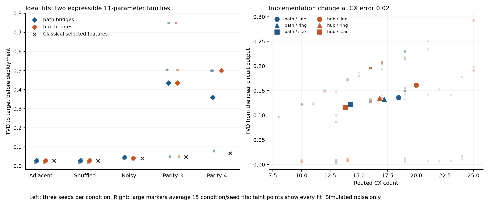

# Routing controls: complete tables

Every configuration from the [frozen protocol](routing-controls-protocol.md). Values are three-seed means; the [summary JSON](routing-controls-summary.json) includes every seed and secondary metric.

| Condition | Circuit | Device | CX gates | Ideal target TVD | Target TVD at 0.005 | Target TVD at 0.02 | Output change at 0.02 |
|---|---|---|---:|---:|---:|---:|---:|
| Adjacent pairs | path_bridges | line | 9.3 | 0.0265 | 0.0422 | 0.1143 | 0.1139 |
| Adjacent pairs | path_bridges | ring | 9.3 | 0.0265 | 0.0422 | 0.1143 | 0.1139 |
| Adjacent pairs | path_bridges | star | 14.7 | 0.0265 | 0.0558 | 0.1813 | 0.1810 |
| Adjacent pairs | hub_bridges | line | 16.3 | 0.0265 | 0.0607 | 0.1969 | 0.1965 |
| Adjacent pairs | hub_bridges | ring | 17.7 | 0.0265 | 0.0631 | 0.2058 | 0.2054 |
| Adjacent pairs | hub_bridges | star | 15.3 | 0.0265 | 0.0585 | 0.1886 | 0.1883 |
| Shuffled pairs | path_bridges | line | 18.3 | 0.0264 | 0.0670 | 0.2228 | 0.2226 |
| Shuffled pairs | path_bridges | ring | 18.3 | 0.0264 | 0.0670 | 0.2228 | 0.2226 |
| Shuffled pairs | path_bridges | star | 15.3 | 0.0264 | 0.0584 | 0.1882 | 0.1880 |
| Shuffled pairs | hub_bridges | line | 23.7 | 0.0265 | 0.0819 | 0.2791 | 0.2788 |
| Shuffled pairs | hub_bridges | ring | 16.3 | 0.0265 | 0.0613 | 0.2024 | 0.2021 |
| Shuffled pairs | hub_bridges | star | 14.7 | 0.0265 | 0.0555 | 0.1804 | 0.1801 |
| Noisy pairs | path_bridges | line | 19.0 | 0.0447 | 0.0609 | 0.1609 | 0.1518 |
| Noisy pairs | path_bridges | ring | 19.0 | 0.0447 | 0.0609 | 0.1609 | 0.1518 |
| Noisy pairs | path_bridges | star | 16.0 | 0.0447 | 0.0561 | 0.1385 | 0.1289 |
| Noisy pairs | hub_bridges | line | 25.0 | 0.0400 | 0.0683 | 0.2031 | 0.1933 |
| Noisy pairs | hub_bridges | ring | 17.0 | 0.0400 | 0.0552 | 0.1474 | 0.1376 |
| Noisy pairs | hub_bridges | star | 16.0 | 0.0400 | 0.0535 | 0.1386 | 0.1287 |
| Three-bit parity | path_bridges | line | 21.7 | 0.4341 | 0.4527 | 0.5161 | 0.1207 |
| Three-bit parity | path_bridges | ring | 20.3 | 0.4341 | 0.4519 | 0.5116 | 0.1184 |
| Three-bit parity | path_bridges | star | 12.3 | 0.4341 | 0.4440 | 0.4771 | 0.0714 |
| Three-bit parity | hub_bridges | line | 21.0 | 0.4340 | 0.4541 | 0.5229 | 0.1278 |
| Three-bit parity | hub_bridges | ring | 19.0 | 0.4340 | 0.4522 | 0.5152 | 0.1183 |
| Three-bit parity | hub_bridges | star | 13.0 | 0.4340 | 0.4452 | 0.4850 | 0.0798 |
| Four-bit parity | path_bridges | line | 24.0 | 0.3589 | 0.3684 | 0.4022 | 0.0693 |
| Four-bit parity | path_bridges | ring | 19.0 | 0.3589 | 0.3661 | 0.3909 | 0.0555 |
| Four-bit parity | path_bridges | star | 13.0 | 0.3589 | 0.3638 | 0.3791 | 0.0392 |
| Four-bit parity | hub_bridges | line | 14.0 | 0.5000 | 0.5000 | 0.5000 | 0.0096 |
| Four-bit parity | hub_bridges | ring | 14.0 | 0.5000 | 0.5000 | 0.5000 | 0.0096 |
| Four-bit parity | hub_bridges | star | 10.0 | 0.5000 | 0.5000 | 0.5000 | 0.0066 |

Output change is TVD between noisy and ideal model distributions. It differs from the change in TVD to the target. Noise can reduce target error for a poorly fitted circuit without making its implementation more faithful.

The audit replayed 30 training fits and 270 compiled noise evaluations, including sample counts. Maximum noiseless probability discrepancy was 8.86e-10; the final protocol's numerical bound is 1e-8.
